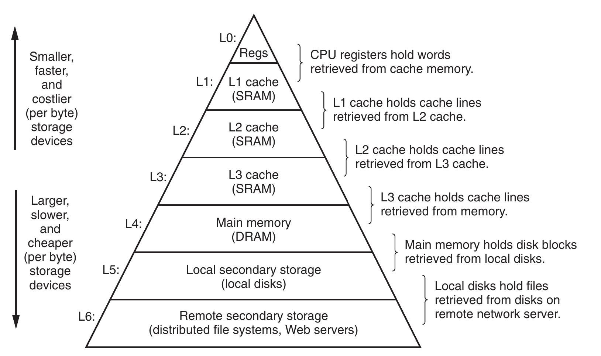
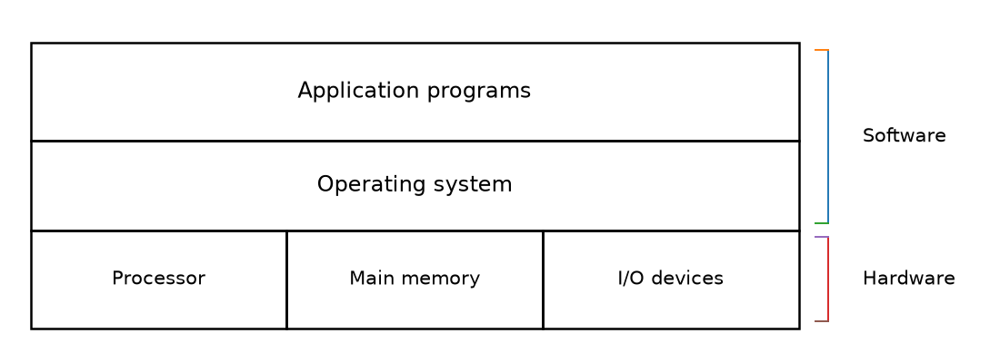
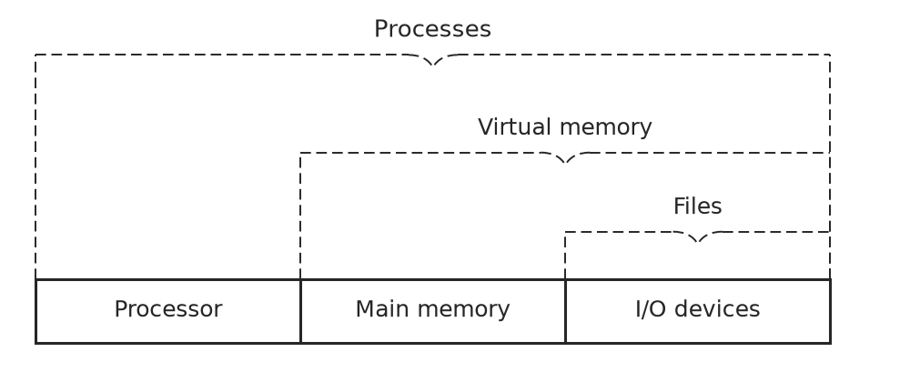
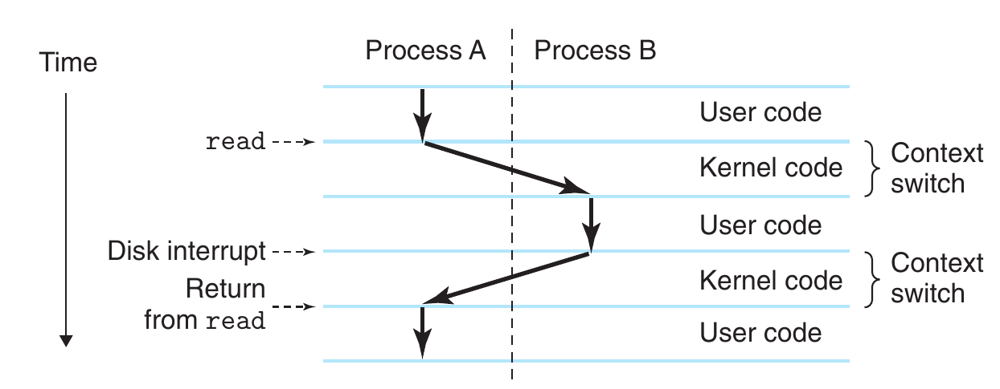
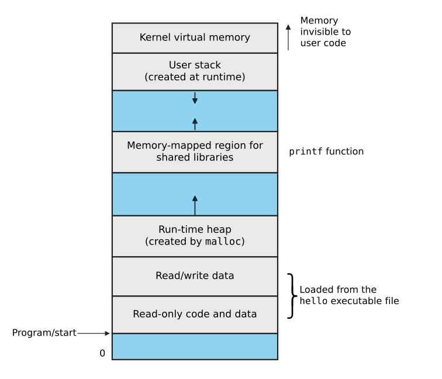

#+title:      csapp-chapter1-A-Tour-of-Computer-Systems
#+date:       [2026-10-01 Thu 22:02]
#+filetags:   :csapp:
#+identifier: 20261001T220252
* Information Is Bits + Context
:PROPERTIES:
:CUSTOM_ID: h:163714d0-7169-426a-8018-bf5f4b68288a
:END:

从一个简单的 C 程序开始:

#+name: hello
#+begin_src C :results output :tangle build/chapter1/hello.c :mkdirp yes
  #include <stdio.h>

  int main()
  {
    printf("hello, world!\n");
    return 0;
  }
#+end_src

#+RESULTS: hello
: hello, world!

从追踪 ~hello~ 的整个生命周期开始。

hello 程序以 source file 的形式存在。这个源程序以一串位(bit)组成，每个位的取值都是0或1 。这些位按照每8位一组的形式组织，每一组是一个字节(byte) 。程序中的每个字节都表示 *一个文本字符* 。

每个字节都有一个整数值，并与某个字符相对应。

#+name :char_int
#+begin_src C :results output
  #include <stdio.h>

  int main()
  {
    printf("# is %d\n", '#');
    printf("i is %d\n", 'i');
    printf("n is %d\n", 'n');
    printf("c is %d\n", 'c');
    printf("l is %d\n", 'l');
    printf("u is %d\n", 'u');
    printf("d is %d\n", 'd');
    printf("e is %d\n", 'e');
    printf("SP is %d\n", ' ');
    printf("\\n is %d\n", '\n');
    return 0;
  }
#+end_src

#+RESULTS:
#+begin_example
# is 35
i is 105
n is 110
c is 99
l is 108
u is 117
d is 100
e is 101
SP is 32
\n is 10
#+end_example
这里的整数值就是它们在 ASCII 中的编码。注意每一行以一个不可见的 ~\n~ 结尾，整数值是10.

- 完全由 ASCII 组成的文件称为文本文件(text file)
- 其他所有文件都称为二进制文件(binary file)

这里就体现了一个基本思想:

#+begin_quote
系统中的所有信息——包括磁盘文件、存储在内存中的程序、存储在内存中的用户数据，以及通过网络传输的数据——本质上都是由一串bit表示的。
#+end_quote

区分不同数据对象(data object)的唯一因素，是我们观察这些bit时 *所处的上下文(context)* 。在不同的上下文中，同一串字节可能表示一个整数、浮点数、字符串或一条机器指令。

* Programs Are Translated by Other Programs into Different Forms

程序会被其他程序翻译成不同的形式。

- 为了让 ~hello.c~ 能够在系统上运行，其中的每条C语句都必须被其他程序翻译成 low-level machine-language instruction.
- 随后，这些指令会被打包成一种称为可执行目标程序(executable object program)的形式
- 并以二进制文件的形式存储在磁盘

从source file 到 object file的翻译工作由编译器驱动程序(compiler driver)完成：

#+name: build-hello
#+begin_src shell :results output
  gcc -Wall -Wextra -o build/chapter1/hello build/chapter1/hello.c
  ./build/chapter1/hello
#+end_src

#+RESULTS: build-hello
: hello, world!

这里，gcc compiler driver 会读取 source file hello.c, 并将其翻译成executable object file: hello.

这一翻译过程被分为四个阶段，执行这四个阶段的程序是:

1. preprocessor(预处理器)
2. compiler(编译器)
3. assembler(汇编器)
4. linker(连接器)

它们被称为 compilation system(编译系统)

过程如图所示:

#+RESULTS: compile-pipeline
[[file:build/chapter1/compile-pipeline.svg]]

#+name: compile-pipeline
#+begin_src dot :file build/chapter1/compile-pipeline.svg :cmdline -Kdot -Tsvg
  digraph compile_pipeline {
      rankdir=LR;
      node [
            shape=box,
            style="rounded",
            fontname="monospace",
            fontsize=14
            ];

      edge [
            fontname="monospace",
            fontsize=12
            ];

      source [
              shape=plain,
              label="hello.c\n\nSource program\n(text)"
              ];

      cpp [
           label="Preprocessor\n(cpp)"
           ];

      modified [
                shape=plain,
                label="hello.i\n\nModified source\nprogram\n(text)"
                ];

      cc1 [
           label="Compiler\n(cc1)"
           ];

      assembly [
                shape=plain,
                label="hello.s\n\nAssembly program\n(text)"
                ];

      assembler [
                 label="Assembler\n(as)"
                 ];

      object [
              shape=plain,
              label="hello.o\n\nRelocatable object\nprograms\n(binary)"
              ];

      linker [
              label="Linker\n(ld)"
              ];

      executable [
                  shape=plain,
                  label="hello\n\nExecutable object\nprogram\n(binary)"
                  ];

      source -> cpp;
      cpp -> modified;
      modified -> cc1;
      cc1 -> assembly;
      assembly -> assembler;
      assembler -> object;
      object -> linker;
      linker -> executable;
  }
#+end_src

1. Preprocessing phase: 预处理阶段。预处理器(preprocessor, cpp)会根据以字符 ~#~ 开头的指令来修改原始C程序。例如 ~hello.c~ 中第一行的 ~#include <stdio.h>~ 命令会告诉cpp读取系统头文件 ~stdio.h~ 的内容，并把它 *直接插入到程序文本中* 。结果仍然是一个C程序，通常后缀是 ~.i~

   #+name: hello.i
   #+begin_src shell :results output
     gcc -E build/chapter1/hello.c -o build/chapter1/hello.i
     cat build/chapter1/hello.i | rg 'printf' -A 3 -B 3
   #+end_src

   #+RESULTS: hello.i
   #+begin_example

   extern int fprintf (FILE *__restrict __stream,
         const char *__restrict __format, ...) __attribute__ ((__nonnull__ (1)));

   extern int printf (const char *__restrict __format, ...);

   extern int sprintf (char *__restrict __s,
         const char *__restrict __format, ...) __attribute__ ((__nothrow__));

   extern int vfprintf (FILE *__restrict __s, const char *__restrict __format,
          __gnuc_va_list __arg) __attribute__ ((__nonnull__ (1)));

   extern int vprintf (const char *__restrict __format, __gnuc_va_list __arg);

   extern int vsprintf (char *__restrict __s, const char *__restrict __format,
          __gnuc_va_list __arg) __attribute__ ((__nothrow__));

   extern int snprintf (char *__restrict __s, size_t __maxlen,
          const char *__restrict __format, ...)
        __attribute__ ((__nothrow__)) __attribute__ ((__format__ (__printf__, 3, 4)));

   extern int vsnprintf (char *__restrict __s, size_t __maxlen,
           const char *__restrict __format, __gnuc_va_list __arg)
        __attribute__ ((__nothrow__)) __attribute__ ((__format__ (__printf__, 3, 0)));

   extern int vasprintf (char **__restrict __ptr, const char *__restrict __f,
           __gnuc_va_list __arg)
        __attribute__ ((__nothrow__)) __attribute__ ((__format__ (__printf__, 2, 0))) ;
   extern int __asprintf (char **__restrict __ptr,
            const char *__restrict __fmt, ...)
        __attribute__ ((__nothrow__)) __attribute__ ((__format__ (__printf__, 2, 3))) ;
   extern int asprintf (char **__restrict __ptr,
          const char *__restrict __fmt, ...)
        __attribute__ ((__nothrow__)) __attribute__ ((__format__ (__printf__, 2, 3))) ;

   extern int vdprintf (int __fd, const char *__restrict __fmt,
          __gnuc_va_list __arg)
        __attribute__ ((__format__ (__printf__, 2, 0)));
   extern int dprintf (int __fd, const char *__restrict __fmt, ...)
        __attribute__ ((__format__ (__printf__, 2, 3)));

   --
   # 3 "build/chapter1/hello.c"
   int main()
   {
     printf("hello, world!\n");
     return 0;
   }
   #+end_example
   我们看到，调用的 ~printf~ 已经被插入进了 ~hello.i~ 中。

2. Compilation phase: 编译阶段. 编译器(compiler, cc1)会将文本文件 ~hello.i~ 翻译成文本文件 ~hello.s~, 它包含一个汇编语言程序.

   #+name: hello.s
   #+begin_src shell :results output
     gcc -S build/chapter1/hello.i -o build/chapter1/hello.s
     cat build/chapter1/hello.s
   #+end_src

   #+RESULTS: hello.sp
   #+begin_example
           .file	"hello.c"
           .text
           .section	.rodata
   .LC0:
           .string	"hello, world!"
           .text
           .globl	main
           .type	main, @function
   main:
   .LFB0:
           .cfi_startproc
           endbr64
           pushq	%rbp
           .cfi_def_cfa_offset 16
           .cfi_offset 6, -16
           movq	%rsp, %rbp
           .cfi_def_cfa_register 6
           leaq	.LC0(%rip), %rax
           movq	%rax, %rdi
           call	puts@PLT
           movl	$0, %eax
           popq	%rbp
           .cfi_def_cfa 7, 8
           ret
           .cfi_endproc
   .LFE0:
           .size	main, .-main
           .ident	"GCC: (Gentoo 16.2.1_p20260926 p1) 16.2.1 20260926"
           .section	.note.GNU-stack,"",@progbits
           .section	.note.gnu.property,"a"
           .align 8
           .long	1f - 0f
           .long	4f - 1f
           .long	5
   0:
           .string	"GNU"
   1:
           .align 8
           .long	0xc0000002
           .long	3f - 2f
   2:
           .long	0x3
   3:
           .align 8
   4:
   #+end_example

   汇编语言(asscembly language)可以作为不同高级语言编译器共同使用的一种输出语言。
3. Assembly phase: 汇编阶段. 汇编器(assembler, as) 会把 ~hello.s~ 翻译成机器语言指令，并将这些指令打包成 relocatable object program(可重定向目标程序)，并把结果保存在 ~hello.o~ 这个 object file 里。

   #+name: hello.o
   #+begin_src shell :results output
     gcc -c build/chapter1/hello.s -o build/chapter1/hello.o
     nm build/chapter1/hello.o
   #+end_src

   #+RESULTS: hello.o
   : 0000000000000000 T main
   :                  U puts

   这里我们使用 ~nm~ (Linux nm Command),  来查看 object file 中的符号信息。得到的结果是 ~U puts~, 说明这个符号我们使用了，但是没有定义， *需要从另外的文件链接* ，而这就是下一步 ~linker~ 要做的事情
4. Linking phase: 链接阶段。我们的 ~hello~ 使用了 ~printf~ 函数，而这个函数位于 standard C library 中。因此必须通过 ~linker, ld~ 将 ~hello.o~ 与这个文件链接起来。

   #+name: hello executable
   #+begin_src shell :results output
     gcc -o build/chapter1/hello build/chapter1/hello.o
     ./build/chapter1/hello
   #+end_src

   #+RESULTS: hello executable
   : hello, world!

   这个过程，linker 会完成 ~hello.o~ 与C标准库文件的合并，最终得到一个 executable object file ~hello~ ，简称为可执行文件(executable). 到这时， ~hello~ 已经可以被加载到内存中，并被系统执行了。

* It Pays to UnderStand How Compilation System Work

了解 compilation system(编译系统) 如何工作是大有益处的。

- 优化程序性能。现代编译器通常都能生成质量很好的代码，作为程序员不需要了解编译器的内部工作原理也能写出高效的代码。但是，在编写C程序时也确实需要对机器级的代码，以及编译器如何把不同的C语句翻译成机器码有一个基本的了解。
- 理解链接时错误(link-time errors). 某些最令人困惑的程序错误通常都与 linker 有关。
- 避免安全漏洞。

* Processor Read and Interpret Instructions Stored in Memory

** Hardware Organization of a System

系统的硬件组成。典型系统的硬件组成可以参见 [[file:~/Learning/org-learning/40-resources/csapp/Computer Systems A Programmer’s Perspective, Third Edition (Global Edition) ( etc.) (z-library.sk, 1lib.sk, z-lib.sk).pdf][CSAPP]] 第43页 Figure 1.4

*** Buses(总线)

一组电气通道(electrical conduits), 被称为总线(buses), 贯穿整个系统，负责在各个部件之间来回传递信息字节。

总线通常被设计成 *传送固定大小的字节块* ，这种字节块被称为 *字(word)* . 一个 word 中包含的字节数被称为 *word size(字长)* 。不同系统的 word size 可能不同。

现如今大多数机器的字长要么是4字节(32 bits) ，要么是8字节(64 bits)

*** I/O Devices

输入/输出设备是系统与外部世界之间的连接。

每个 I/O 设备都通过控制器(controller) 或者 适配器(adapter) 链接到 I/O 总线 上。两者之间的区别主要在封装形式上：

- controller 通常位于 *设备本身内部* ，或者位于 *系统主印刷电路板(main printed circuit board, 通常被称为 主板 motherboard)* 上的一组芯片
- adapter 是插入主板插槽里的板卡

它们的目的都是在 I/O 总线和 I/O 设备之间双向传递信息。

*** Main memory(主存)

主存是一种临时的存储设备。当处理器正在执行一个程序时，主存既保存这个程序，也保存程序所操作的数据。

- 物理上，主存是一组动态随机访问存储器芯片(dynamic random access memory, DRAM) 组成
- 逻辑上，内存被组织成一个线性的字节数组(linear array of bytes), 其中每个字节都有一个从0开始的唯一地址(address, 也可以看成数组下标 array index)

*** Processor(处理器)

中央处理器(central processing unit, CPU) 简称处理器，负责解释(interpret) 或 执行(execute) 存储在主存中的指令的核心部件。

处理器的核心位置有一个字长大小的存储设备，也就是一个 register(寄存器) ，被称为程序计数器(Program counter, PC).

PC在任何时刻 *都指向主存中的某条机器语言指令* ，也就是说 *PC中保存着这条指令的地址* 。

处理器遵循一种非常简单的指令执行模型(instruction execution model), 这个模型由它的指令集体系结构(instruction set architecture, ISA)定义.

执行一条指令需要完成一系列步骤:

1. 处理器首先从PC指向的内存位置读取指令
2. 解释指令中的各个bit
3. 执行该指令所指定的某种简单操作
4. 更新PC, 另其指向下一条指令

这些基本操作主要围绕三个部件展开:

- main memory(主存)
- register file(寄存器文件)
- arithmetic / logic unit, ALU (算术/逻辑单元)

register file 是一种小型存储设备，由一组 *字长大小* 的寄存器组成，每个寄存器都有自己唯一的名字。

ALU用来计算新的数据值的地址值。

CPU在某条指令的要求下可能执行一些简单的操作:

- Load(加载): 把一个 byte 或一个 word 从主存复制到某个register中，并覆盖这个 register 原先的内容
- Store(存储): 把一个 byte 或一个 word 从寄存器复制到主存中的某个位置，并覆盖原先该位置的内容
- Jump(跳转): 从指令本身中取出一个 word, 并把这个 word 复制到PC中，从而覆盖PC原来的值
- Operate(运算): 把两个寄存器的内容送入 ALU 中，并对这两个 word 进行某种算术运算，最后把结果存入某个寄存器里，并覆盖那里原来的内容

但实际上，现代寄存器会使用大量复杂得多的机制来加快程序执行，并不仅仅是 ISA 的简单实现。

所以需要区分两个概念:

- Instruction Set Architecture, ISA: 描述每条机器代码指令会产生什么效果
- microarchitecture(微体系指令): 描述处理器实际上是如何实现这些指令的

** Running the ~hello~ Program

当我们输入 ~/.hello~ 的时候，shell 会把每个字符存入到一个寄存器里，然后再把它存入内存中。

当按下回车时，shell就知道命令已经输入完成。

接下来，shell会通过一系列指令来加载(load)可执行文件 ~hello~, 这些指令会将 ~hello object file~ 中的代码和数据从磁盘复制到主存中。这些数据中就包含字符串 ~hello, world\n~ ，它最终会被输出到屏幕上。

可以参照 [[file:~/Learning/org-learning/40-resources/csapp/Computer Systems A Programmer’s Perspective, Third Edition (Global Edition) ( etc.) (z-library.sk, 1lib.sk, z-lib.sk).pdf][CSAPP]] 46页 figure 1.5 .

这里会用到一种被称为直接存储器访问(direct memory access, DMA)的技术。借助DMA, 数据可以直接从磁盘传送到主存，而不需要经过处理器。

一旦 ~hello object file~ 中的代码和数据被加载到内存中，处理器就开始执行 ~hello~ 程序中的 ~main routine~ 的机器语言指令。这些指令会把字符串 ~hello, world\n~ 对应的各个字节从内存复制到 register file 中，再从g register file 传送到显示设备，最终显示在屏幕上。这些字节都是沿着bus传递的。

* Caches Matter

高速缓存(Caches) 至关重要。

- ~hello~ 的机器指令经过 磁盘 -> 主存 -> 处理器的几个复制，同样的，字符串 ~hello, world\n~ 会经过 磁盘 -> 主存 -> 显示设备 的几个复制。这些复制操作中的很大一部分都属于额外开销 (overhead), 因此一个核心目标就是 *让这些复制操作尽可能快地完成*
- 存储设备中，容量越大，通常越贵；速度越快，通常越贵
- 寄存器容量很小但极快，主存容量很大但明显很慢，而且处理器性能提升速度长期高于内存性能提升速度，于是就形成了 processor-memory gap
- 于是就引入了 cache, 充当一个临时的中转区域:
  - 处理器芯片上具有一级高速缓存(L1 Cache), 可以保存数万字节的数据，访问速度几乎与 register file 一样快
  - 二级高速缓存(L2 Cache) 容量更大，同茶功能可以保存数十万到数百万字节的数据，通过 *special bus* 与处理器相连

    处理器访问 L2 cache 所需的时间可能是L1的5倍左右。但访问L2仍然比访问主存快5-10倍。L1和L2 cache 都采用 *静态随机访问存储器(static random access memory, SRAM)* 的硬件技术实现。
  - 现代系统中还常见L3 cache

Cache 的核心思想就是 Locality(局部性)：程序倾向于访问集中于某些局部区域的数据和代码。

只要把那些可能被高频访问的数据放入cache中，大多数内存操作都可以通过速度更快的cache完成，而不需要每次都经过速度较慢的主存。

* Storage Decvices From a Hierarchy

存储设备形成层次结构。

上述的在处理器、主存(容量更大、速度更慢的存储设备)之间插入一个容量更小、速度更快的存储设备（高速缓存）的思想，其实具有非常普遍的意义。

如图所示:

register file 位于整个层次结构的最顶层，这一级是 L0. 还有三级高速缓存 L1, L2, L3.

存储器层次结构的核心思想是:

#+begin_quote
某一层的存储设备，会作为它下一层的高速缓存。
#+end_quote

因此，

- register file 是 L1 cache 的缓存
- L1 cache 是 L2 cache 的缓存
- L2 cache 是 L3 cahce 的缓存
- L3 cache 是 主存 的缓存
- 主存 是 磁盘 的缓存

cache 并不专指CPU里的L1/L2/L3。 一般来说，只要上一层保存了下一层中一部分近期可能需要的数据，上一层就能看作下一层的 cache

* The Operating System Manages the Hardware

~hello~ 程序中，shell 加载并运行它，以及 ~hello~ 打印消息的时候，依赖的是操作系统提供的服务。

操作系统是位于应用程序(Application program) 与硬件(hardware) 之间的一层软件。如图所示，当应用程序试图操作硬件的时候，必须通过操作系统。

#+RESULTS: Layer view of a computer system

#+name: Layer view of a computer system
#+begin_src python :results output file graphics :file figure/chapter1/system-organization.png :exports results

  import os
  import matplotlib.pyplot as plt
  from matplotlib.patches import Rectangle

  os.makedirs("figure/chapter1", exist_ok=True)

  fig, ax = plt.subplots(figsize=(11, 4))

  # ------------------------------------------------------------
  # Layout
  # ------------------------------------------------------------

  x0 = 0.0
  width = 9.0

  hardware_h = 1.15
  os_h = 1.05
  app_h = 1.15

  y_hardware = 0.0
  y_os = y_hardware + hardware_h
  y_app = y_os + os_h

  # ------------------------------------------------------------
  # Application programs
  # ------------------------------------------------------------

  ax.add_patch(
      Rectangle(
          (x0, y_app),
          width,
          app_h,
          fill=False,
          linewidth=1.8,
      )
  )

  ax.text(
      x0 + width / 2,
      y_app + app_h / 2,
      "Application programs",
      ha="center",
      va="center",
      fontsize=17,
      fontweight="medium",
  )

  # ------------------------------------------------------------
  # Operating system
  # ------------------------------------------------------------

  ax.add_patch(
      Rectangle(
          (x0, y_os),
          width,
          os_h,
          fill=False,
          linewidth=1.8,
      )
  )

  ax.text(
      x0 + width / 2,
      y_os + os_h / 2,
      "Operating system",
      ha="center",
      va="center",
      fontsize=17,
      fontweight="medium",
  )

  # ------------------------------------------------------------
  # Hardware
  # ------------------------------------------------------------

  hardware = [
      "Processor",
      "Main memory",
      "I/O devices",
  ]

  column_width = width / len(hardware)

  for i, label in enumerate(hardware):
      x = x0 + i * column_width

      ax.add_patch(
          Rectangle(
              (x, y_hardware),
              column_width,
              hardware_h,
              fill=False,
              linewidth=1.8,
          )
      )

      ax.text(
          x + column_width / 2,
          y_hardware + hardware_h / 2,
          label,
          ha="center",
          va="center",
          fontsize=15,
      )

  # ------------------------------------------------------------
  # Right-side grouping
  # ------------------------------------------------------------

  group_x = width + 0.35
  text_x = width + 0.75

  # Software group
  software_bottom = y_os
  software_top = y_app + app_h

  ax.plot(
      [group_x, group_x],
      [software_bottom + 0.08, software_top - 0.08],
      linewidth=1.4,
  )

  ax.plot(
      [group_x - 0.15, group_x],
      [software_top - 0.08, software_top - 0.08],
      linewidth=1.4,
  )

  ax.plot(
      [group_x - 0.15, group_x],
      [software_bottom + 0.08, software_bottom + 0.08],
      linewidth=1.4,
  )

  ax.text(
      text_x,
      (software_bottom + software_top) / 2,
      "Software",
      ha="left",
      va="center",
      fontsize=15,
      fontweight="medium",
  )

  # Hardware group
  hardware_bottom = y_hardware
  hardware_top = y_hardware + hardware_h

  ax.plot(
      [group_x, group_x],
      [hardware_bottom + 0.08, hardware_top - 0.08],
      linewidth=1.4,
  )

  ax.plot(
      [group_x - 0.15, group_x],
      [hardware_top - 0.08, hardware_top - 0.08],
      linewidth=1.4,
  )

  ax.plot(
      [group_x - 0.15, group_x],
      [hardware_bottom + 0.08, hardware_bottom + 0.08],
      linewidth=1.4,
  )

  ax.text(
      text_x,
      (hardware_bottom + hardware_top) / 2,
      "Hardware",
      ha="left",
      va="center",
      fontsize=15,
      fontweight="medium",
  )

  # ------------------------------------------------------------
  # Figure appearance
  # ------------------------------------------------------------

  ax.set_xlim(-0.2, 11.2)
  ax.set_ylim(-0.2, 3.65)

  ax.set_aspect("equal", adjustable="box")
  ax.axis("off")

  fig.tight_layout()
#+end_src

操作系统有两个目的：

1. 保护硬件，防止失控的应用程序(runaway applications)对其进行不当使用
2. 为应用程序提供简单而统一的机制，使其能够操纵复杂且通常差异巨大的底层硬件设备(low-level hardware devices)

操作系统通过下图所示的三个基本抽象来实现这两个目的:

- 进程(processes)
- 虚拟内存(virtual memory)
- 文件(files)

#+RESULTS: abstractions provided by an operating system

#+name: abstractions provided by an operating system
#+begin_src python :results output file graphics :file figure/chapter1/processes-vm-files.png :exports results
import os
import matplotlib.pyplot as plt
from matplotlib.patches import Rectangle, PathPatch
from matplotlib.path import Path

os.makedirs("figure/chapter1", exist_ok=True)

fig, ax = plt.subplots(figsize=(10, 4.2))

# ------------------------------------------------------------
# Helpers
# ------------------------------------------------------------

def draw_braced_span(ax, x1, x2, y_top, y_bottom, label,
                     gap=0.28, drop=0.12,
                     lw=1.4, dash=(0, (6, 3)),
                     color="0.15", text_size=19):
    """
    Draw a top spanning dashed bracket with a small central brace dip.
    """
    mid = (x1 + x2) / 2

    # left vertical
    ax.plot(
        [x1, x1],
        [y_bottom, y_top],
        linestyle=dash,
        linewidth=lw,
        color=color,
    )

    # right vertical
    ax.plot(
        [x2, x2],
        [y_bottom, y_top],
        linestyle=dash,
        linewidth=lw,
        color=color,
    )

    # top horizontal (left and right segments)
    ax.plot(
        [x1, mid - gap],
        [y_top, y_top],
        linestyle=dash,
        linewidth=lw,
        color=color,
    )

    ax.plot(
        [mid + gap, x2],
        [y_top, y_top],
        linestyle=dash,
        linewidth=lw,
        color=color,
    )

    # central brace-like dip
    verts = [
        (mid - gap, y_top),
        (mid - 0.08, y_top),
        (mid, y_top - drop),
        (mid + 0.08, y_top),
        (mid + gap, y_top),
    ]
    codes = [
        Path.MOVETO,
        Path.CURVE3,
        Path.CURVE3,
        Path.CURVE3,
        Path.CURVE3,
    ]
    patch = PathPatch(
        Path(verts, codes),
        fill=False,
        linewidth=lw,
        linestyle=dash,
        edgecolor=color,
    )
    ax.add_patch(patch)

    ax.text(
        mid,
        y_top + 0.12,
        label,
        ha="center",
        va="bottom",
        fontsize=text_size,
        color=color,
    )

# ------------------------------------------------------------
# Base hardware boxes
# ------------------------------------------------------------

x0 = 0.0
total_w = 9.0
box_h = 0.62
y0 = 0.25
col_w = total_w / 3

# outer box
ax.add_patch(
    Rectangle(
        (x0, y0),
        total_w,
        box_h,
        fill=False,
        linewidth=2.2,
        edgecolor="0.15",
    )
)

# separators
for x in [x0 + col_w, x0 + 2 * col_w]:
    ax.plot(
        [x, x],
        [y0, y0 + box_h],
        linewidth=2.2,
        color="0.15",
    )

# labels in hardware boxes
labels = ["Processor", "Main memory", "I/O devices"]

for i, label in enumerate(labels):
    xc = x0 + (i + 0.5) * col_w
    ax.text(
        xc,
        y0 + box_h / 2,
        label,
        ha="center",
        va="center",
        fontsize=18,
        color="0.15",
    )

# ------------------------------------------------------------
# Spanning dashed brackets
# ------------------------------------------------------------

y_base = y0 + box_h

# Processes spans all three boxes
draw_braced_span(
    ax,
    x1=x0,
    x2=x0 + total_w,
    y_top=3.05,
    y_bottom=y_base,
    label="Processes",
    text_size=19,
)

# Virtual memory spans main memory + I/O devices
draw_braced_span(
    ax,
    x1=x0 + col_w,
    x2=x0 + total_w,
    y_top=2.10,
    y_bottom=y_base,
    label="Virtual memory",
    text_size=18,
)

# Files spans I/O devices
draw_braced_span(
    ax,
    x1=x0 + 2 * col_w,
    x2=x0 + total_w,
    y_top=1.33,
    y_bottom=y_base,
    label="Files",
    text_size=18,
)

# ------------------------------------------------------------
# Layout
# ------------------------------------------------------------

ax.set_xlim(-0.25, 9.75)
ax.set_ylim(0.0, 3.45)
ax.axis("off")
fig.tight_layout()
#+end_src

图中的 Processor, Main memory 和 I/O devices 都是真实存在的底层硬件。而抽象就是：

- file 是对I/O 设备的抽象
- Virtual memory 是对 主存 和 I/O 设备的抽象
- Processes 是对处理器、主存 和 I/O设备 的抽象

操作系统一方面负责保护和管理硬件，另一方面通过 processes / virtual memory / file 三个核心抽象，把复杂硬件包装成应用程序容易使用的统一接口。

** Processes(进程)

当 ~hello~ 在现代系统上运行的时候，os会制造一种假象(illusion): 仿佛这个程序是系统中唯一正在运行的程序。

这个程序看起来似乎独占了处理器、主存和I/O设备。处理器看起来不受任何干扰地、一条一条地执行该程序的指令。程序的代码和数据，看起来也是内存中唯一存在的对象。

这些 illusion 正是由 process(进程) 这一概念提供的。

- 进程是操作系统对一个正在运行的程序(running program) 的抽象。
- 同一个系统上可以并发(concurrently)运行多个进程，而每个进程都看起来像是独占硬件
  - *concurrent*: 一个进程的指令与另一个进程的指令交错执行(interleaved)

program 是静态的程序代码，而 process 是“正在运行的程序”的抽象。多个进程可以通过指令交错执行而形成并发。

-----

单个CPU可以通过在多个进程之间不断切换，使自己看起来像在并发执行多个进程。操作系统通过 *context switching(上下文切换)* 的机制完成这种交错执行。

OS 会记录一个进程运行时所需要的全部状态信息，这些状态统称为context(上下文)，其中包括:

- 程序计数器(PC) 的当前值
- register file 的当前状态
- main memory 中的相关内容等

在任意一个时刻，单处理器只能处理一个进程的代码。当 OS 决定把控制权从当前进程转移到另一个进程时，它就会执行一次 *context switch(上下文切换)*:

1. 保存当前进程的 context
2. 恢复新进程的 context
3. 将控制权交给新进程

如图展示了 ~hello~ 中的基本过程。

#+begin_quote
context 就是一个让进程能够“暂停后继续”的运行状态。上下文切换的核心就是“保存旧状态->恢复新状态->切换执行”。
#+end_quote

-----

在我们的示例中，有两个并发进程:

- shell 进程
- hello 进程

当要求shell运行hello程序时，shell会调用 *system call(系统调用)* 的特殊函数，从而把控制权交给操作系统。

操作系统随后会进行 context switch:

1. 保存 shell 的 context
2. 创建一个新的 hello 进程以及它的 context
3. 把控制权交给新的 hello 进程

当hello终止后，操作系统恢复shell的上下文(这也是一次 context switch), 并把控制权交给shell. 随后shell又等待下一条命令输入。

-----

上述的 从一个进程切换到另一个进程的过程，是由 OS kernel(内核) 管理的。内核是OS代码中始终 *驻留在内存(resident in memory)* 的部分。

当应用程序需要OS执行某项操作时，它会执行一条特殊的系统调用指令(system call instruction), 从而把控制权转移给kernel.

kernel 完成所请求的操作后，再把控制权返回给程序。

*kernel 本身并不是一个独立的进程* 。kernel 是一组code和data structures, 系统利用它们来管理所有进程。

#+begin_quote
system call 是用户程序进入kernel, 请求OS服务的重要机制。kernel 不是普通进程，而是管理进程和系统资源的一组常驻内存的代码与数据结构
#+end_quote

-----

** Threads(线程)

一个process(进程)可以由多个 *执行单元* 组成，这些执行单元被称为 *Threads(线程)* .

每个线程都运行在该进程的 context 中，并共享相同的代码和全局数据 (global data)

线程越来越重要:

- 网络服务器需要并发
- 多个线程之间共享数据通常比多个进程之间共享数据更加容易
- 线程通常比进程更加高效

当系统中存在多个处理器时， multi-threading(多线程)也是提高程序运行速度的一种方式。

** Virtual Memory(虚拟内存)

virtual memory 是一种抽象，它让每个进程产生一种假象: 仿佛自己独占了整个主存。

每个进程看到的内存都具有相同而统一的形式。这种内存视图被称为 virtual address space(虚拟地址空间)。

如图展示了 Linux 进程的 virtual address space:

#+name: process virtual address space
#+begin_src python :results output file graphics :file figure/chapter1/process-virtual-address.space.svg
  import matplotlib.pyplot as plt
  from matplotlib.patches import Rectangle, FancyArrowPatch

  fig, ax = plt.subplots(figsize=(10.5, 9))

  ax.set_xlim(0, 10.8)
  ax.set_ylim(0, 9.8)
  ax.axis('off')

  # 主存区域
  x0, x1 = 2.2, 6.6
  w = x1 - x0

  gray = "#e9e9e9"
  blue = "#8fd3f0"
  edge = "#222222"

  regions = [
      (0.35, 1.05, blue, ""),
      (1.05, 2.05, gray, "Read-only code and data"),
      (2.05, 3.10, gray, "Read/write data"),
      (3.10, 4.20, gray, "Run-time heap\n(created by $\\mathtt{malloc}$)"),
      (4.20, 5.35, blue, ""),
      (5.35, 6.45, gray, "Memory-mapped region for\nshared libraries"),
      (6.45, 7.55, blue, ""),
      (7.55, 8.55, gray, "User stack\n(created at runtime)"),
      (8.55, 9.35, gray, "Kernel virtual memory")
  ]

  for y0, y1, fc, label in regions:
      ax.add_patch(
          Rectangle(
              (x0, y0), w, y1 - y0,
              facecolor=fc, edgecolor=edge, linewidth=2.2
          )
      )

      if label:
          ax.text(
              (x0 + x1) / 2,
              (y0 + y1) / 2,
              label,
              ha="center",
              va="center",
              fontsize=17
          )

  # 栈向低地址增长箭头
  ax.add_patch(
      FancyArrowPatch(
          ((x0 + x1) / 2, 7.52),
          ((x0 + x1) / 2, 7.15),
          arrowstyle="-|>",
          mutation_scale=18,
          linewidth=1.8,
          color=edge
      )
  )

  # 共享库内存向高地址增长
  ax.add_patch(
      FancyArrowPatch(
          ((x0 + x1) / 2, 6.47),
          ((x0 + x1) / 2, 6.85),
          arrowstyle="-|>",
          mutation_scale=18,
          linewidth=1.8,
          color=edge
      )
  )

  # 堆向高地址增长
  ax.add_patch(
      FancyArrowPatch(
          ((x0 + x1) / 2, 4.18),
          ((x0 + x1) / 2, 4.78),
          arrowstyle="-|>",
          mutation_scale=18,
          linewidth=1.8,
          color=edge
      )
  )

  # Program start / 0
  ax.annotate(
      "Program/start",
      xy=(x0, 1.05),
      xytext=(1.25, 1.05),
      ha="right", va="center",
      fontsize=16,
      arrowprops=dict(
          arrowstyle="-|>",
          lw=1.2,
          color=edge,
          shrinkA=0,
          shrinkB=4
      )
  )

  ax.text(
      x0 - 0.18, 0.50, "0",
      ha="right", va="center",
      fontsize=16
  )

  # 右侧 printf function
  ax.text(
      x1 + 0.30, 5.90,
      r"$\mathtt{printf}$ function",
      ha="left", va="center",
      fontsize=16
  )

  # 右下角 Loaded from executable file
  ax.text(
      x1 + 0.22, 2.05,
      "⎫\n⎬\n⎭",
      ha="left", va="center",
      fontsize=29,
      linespacing=0.75
  )

  ax.text(
      x1 + 0.58, 2.05,
      "Loaded from the\n$\\mathtt{hello}$ executable file",
      ha="left", va="center",
      fontsize=16
  )

  # 右上角：Memory invisible to user code
  ax.add_patch(
      FancyArrowPatch(
          (x1 + 0.28, 8.60),
          (x1 + 0.28, 9.35),
          arrowstyle="-|>",
          mutation_scale=18,
          linewidth=1.2,
          color=edge
      )
  )
  ax.text(
      x1 + 0.60, 9.10,
      "Memory\ninvisible to\nuser code",
      ha="left", va="center",
      fontsize=16
  )

  plt.tight_layout()

  fig
#+end_src

#+RESULTS: process virtual address space

在Linux中，地址空间最上方的区域会保留给操作系统中所有进程共享代码和数据。地址空间较低的区域则存放用户进程自己定义的代码和数据。

图中的地址从下到上递增。

按照地址从低到高简单了解一下这些区域:

- Program code and Data: 对于所有进程，代码都从相同的固定地址开始。紧接着是与 global C variables(全局C变量)对应的数据区域。code and data area 可以直接根据 executable object file 进行初始化
- Heap: heap 是运行时动态内存分配的主要区域。Code and Data areas 的大小在进程开始后就 *基本固定* ，而 heap 会随着程序使用 ~malloc~ 和 ~free~ 等C标准库函数动态地扩展或收缩。
- Shared Libraries: 共享库。这一块区域用来保存 shared libraries 的代码和数据，例如 C standard library 或 math library 。与动态链接(dynamic linking)密切相关。
- Stack: 在 user virtual address space(用户虚拟地址空间)的顶层是 User Stack(用户栈)。 Compiler 使用 stack 来实现 function calls(函数调用)。与heap一样， stack 在程序运行过程中也会动态扩展和收缩:
  - 每调用一次函数， stack 就会增长
  - 每从一个函数返回， stack 就会收缩
- Kernel Virtual Memory(内核虚拟地址)：这是地址空间的最顶部区域。应用程序不允许:
  - 读取这一部分的内容
  - 写入这一部分的内容
  - 直接调用内核代码中定义的函数
  应用程序如果需要执行这些操作，就必须请求内核来完成，不能直接访问 kernel virtual memory

address translation: 地址转换。将进程的虚拟内存内容放在磁盘上，并把主存作为磁盘的cache.

这是为了实现虚拟内存，硬件和os软件之间进行的复杂协作之一。硬件需要对processor产生的每一个地址执行 address translation.

-----

** Files(文件)

file 就是一个 sequence of bytes(字节序列)。每一种 I/O 设备都被建模为 file. 系统中的所有输入和输出操作，都是通过读写 file 完成的。完成这些操作使用的是被称为 _Unix I/O_ 的 system calls.

file abstraction 隐藏了底层 I/O 设备之间的差异，只会暴露一个字节序列。程序员只需要面向统一的接口编程，而不用面向具体的硬件。

----

* System Communicate with Other Systems Using Networks

现代系统通常通过网络与其他系统连接起来。

从单个系统的角度来看，网络其实也可以被视为一种 I/O 设备。

- 当系统把一串字节从主存复制到 Network Adapter 时，这些数据会通过网络流向另一台机器
- 类似地，系统也可以读取从其他机器发送过来的数据，并将这些数据复制到自己的主存中。

-----

* Import Themes

从前面的讨论中，我们得到的一个重要认识是:

计算机系统并不仅仅是硬件。它是硬件和软件系统交织形成的整体，二者必须协同工作才能实现最终目标--运行应用软件

下面将介绍一些贯穿计算机系统各个方面的重要概念.

** Amdahl's Law

Gene Amdahl 对于“改进系统某一部分究竟能带来多大效果”提出了一个简单而深刻的观察，这个观察后来被称为 Amdahl's Law. 其核心思想是:

当我们加速系统的某一部分时，这个系统最终能获得多大的性能提升，取决于两个因素:

1. 被加速的部分原先在系统中占多大比重
2. 这一部分本身被加速了多少

考虑一个系统，执行某个应用程序原本需要时间 $T_{old}$ ，假设系统中某一部分占用了总执行时间的比例 $\alpha$ ，而我们把这一部分的性能提高了 $k$ 倍。也就是说，这一部分原本所需要的时间为:

$$
\alpha T_old
$$

经过优化之后，它所需的时间变成:

$$
\frac{\alpha T_{old}}{k}
$$

因此，系统新的总执行时间变成:

$$
(1-\alpha)T_{old} + \frac{\alpha T_{old}}{k}
$$

即:

$$
T_{old}\left[(1-\alpha)+\frac{\alpha}{k}\right]
$$

于是我们可以计算加速比:

$$
S = \frac{T_{old}}{T_{new}}
$$

因此，

$$
S = \frac{1}{(1-\alpha)+/frac{\alpha}{k}}
$$

其中，$\alpha$ 表示可优化部分所占比例， $k$ 表示这一部分自身的加速倍数。

** Concurrency and Parallelism(并发与并行)

有两个需求推动计算机不断进步:

- 我们希望计算机能完成更多事情
- 我们希望计算机运行得更快

当处理器能同时做更多事情时，这两个目标都可以得到改善。

- 并发(concurrency) 表示一个系统中存在多个同时进行的活动。
- 并行(parallelism) 特指使用并发来让系统运行得更快

并行可以在多个不同的抽象层次上加以利用，下面按照系统层次从高到低，介绍其中的三个层次:

*** 线程级并发(Thread-Level Concurrency)

基于 process, 我们可以构造出让多个程序同时执行的系统，由此形成并发。

通过 threads, 甚至可以让一个 process 内部同时存在多条 control flow.

单核CPU也能制造并发效果，其方法就是快速切换进程或线程，这种并发并不意味着多个任务在物理上真正同时执行。

- uniprocessor system: 单处理器系统。只有一个处理器，因此这个处理器必须不断在多个任务之间切换以实现并发。
- multiprocessor system: 多处理器系统。由多个处理器组成、并且这些处理器全部受到同一个OS kernel的控制。

随着多核处理器(multi-core processor)和超线程(hyperthreading)的出现，多处理器系统已经十分普遍。

下图对不同类型的处理器进行了分类:

#+begin_export ascii
 All processors                                        
 +---------------------+--------------------------------------------+
 |                     |                                            |
 |                     |                Multiprocessors             |
 |                     |  +-------------------+-----------------+   |
 |                     |  |                   |                 |   |
 |  Uniprocessors      |  |                   |                 |   |
 |                     |  |  Multicore        | Hyperthreading  |   |
 |                     |  |                   |                 |   |
 |                     |  |                   |                 |   |
 |                     |  +-------------------+-----------------+   |
 |                     |                                            |
 +---------------------+--------------------------------------------+
#+end_export

多核处理器(multi-core processors) 把多个 CPU 集成在同一个集成电路芯片(integrated-circuit chip)上，这些CPU通常称为核。

如图展示了一个典型的多核处理器的组织方式:

#+begin_export ascii
Processor package
+--------------------------------------------------------------------------+
|  Core 0                                  Core 3                          |
|  +---------------------------+           +---------------------------+   |
|  |+------+                   |           |+------+                   |   |
|  || Regs |                   |           || Regs |                   |   |
|  |+---+--+                   |           |+---+--+                   |   |
|  |    |                      |           |    |                      |   |
|  |+---+----+   +--------+    |           |+---+----+   +--------+    |   |
|  ||  L1    |   |  L1    |    |           ||  L1    |   |  L1    |    |   |
|  || d-cache|   | i-cache|    |  . . . .  || d-cache|   | i-cache|    |   |
|  |+----+---+   +----+---+    |           |+----+---+   +----+---+    |   |
|  |     |            |        |           |     |            |        |   |
|  |     |            |        |           |     |            |        |   |
|  |     |            |        |           |     |            |        |   |
|  | +---+------------+---+    |           | +---+------------+---+    |   |
|  | |  L2 unified cache  |    |           | |  L2 unified cache  |    |   |
|  | +--------------------+    |           | +--------------------+    |   |
|  +-------------+-------------+           +--------------+------------+   |
|                |                                        |                |
|                |                                        |                |
|           +----+----------------------------------------+---+            |
|           |                L3 unified cache                 |            |
|           |               (shared by all cores)             |            |
|           +--------------------------+----------------------+            |
+--------------------------------------+-----------------------------------+
                                       |
                                       |
                                       |
+--------------------------------------+-----------------------------------+
|                                  Main memory                             |
+--------------------------------------------------------------------------+

#+end_export

这个芯片中包含4个CPU核, 每个CPU核都有自己的 L1 cache 和 L2 cache. 而每个 L1 cache 又被分为两部分:

- 一部分保存最近取出的指令
- 一部分保存数据

各个核心会共享更高层的 cache, 以及访问主存的接口。

-----

超线程(hyperthreading)，有时也称为 同时多线程(simultaneous multi-threading, SMT) 是一种允许单个CPU执行多条控制流的技术。

它的做法是：对CPU中的一部分硬件 *保存多份副本* ，例如 PC 和 register file. 而对于另一些硬件，只保留一份，例如执行浮点运算的功能单元。

超线程处理器可以逐个时钟周期决定当前执行哪个线程，这样可以使CPU更充分地理由内部的处理资源。例如，如果某个线程必须等待数据被加载到cache中，那么这期间CPU就可以继续执行另一个线程。

*** 指令级并行(Instruction-Level Parallelism, ILP)

现代处理器可以在机器指令层面同时执行多条指令。而前面所说的 thread-level concurrency 是程序或线程层面的并行。

例如早期的微处理器，比如1978年推出的Intel 8086, 执行一条指令通常需要多个时钟周期，一般为3～10个周期。而较新的处理器能够持续达到每个时钟周期处理2～4条指令。这是 ILP 的直接体现。

虽然单条指令的延迟(latency, 指从开始到完成所需的时间)仍然可能很高，需要20个或更多的时钟周期，但处理器会利用很多复杂技巧，同时处理多达100条指令，因此整体吞吐量(throughput)仍然很高。

流水线(pipeline) 会把执行一条指令所需的动作划分为多个步骤，然后把处理器硬件组织成一系列阶段(stage), 每个阶段负责中一个步骤。这些阶段可以并行工作。

*** 单指令多数据并行(Single-Instruction, Multiple-Data Parallelism, SIMD)

在更低的层次上，现代处理器提供特殊的硬件，能让 *一条指令能够并行执行多个操作* 。

例如，较新的 Interl 和 AMD 处理器提供某些指令，可以同时对8对单精度浮点数执行加法运算。

SIMD 指令主要用于加速处理图像、声音、视频等数据。

** The Importance of Abstraction in Computer Systems

使用 abstraction 是计算机科学中最重要的概念之一。abstraction 的作用是隐藏不必要的实现细节，只对使用者暴露一个稳定、简单的接口。

不同编程语言会以不同形式、不同层次支持抽象，例如 Java 的 class declarations 和 C 的 function prototypes .

我们已经接触过计算机系统中的多个抽象，如图:

#+begin_export ascii
                          Virtual machine
+-----------------------------|-------------------------+
|                                                       |
|                                                       |
|                                  Process              |
|                  +------------------|-----------------+
|                  |Instruction set       Vritual       |
|                  |architecture           memory       |
|                  +-----|----+-------------|-----------+
|                  |          |                         |
|                  |          |                 Files   |
|                  |          |            +------|-----+
|                  |          |            |            |
+------------------+----------+------------+------------+
| Operating System |Processor |Main Memory |I/O devices |
+------------------+----------+------------+------------+
#+end_export

在处理器侧，ISA 提供了对真实硬件的抽象。ISA把复杂的CPU抽象成一个简单的顺序执行机器。程序员或机器代码不需要知道CPU的内部如何实现。

实际上，底层硬件要复杂得多，它可能同时执行并行多条指令。但无论其内部实现多么复杂，其最终表现出来的行为都必须与这个简单的顺序执行模型保持一致。

在操作系统侧，我们已经介绍过三个抽象:

- file: 对 I/O 设备的抽象
- virtual memory: 对程序内存的抽象
- process: 对正在运行的程序的抽象

现在再增加一个新的抽象: virtual machine(虚拟机)。虚拟机提供的是对整个计算机系统的抽象，其中包括操作系统、处理器和程序。

* 总结

计算机系统由硬件和系统软件组成。内部信息归根结底都是一组 bits, 其具体含义由所处的 context 决定，不同的context中相同的bits可能被解释为不同含义。程序会经过其他程序的转换而呈现不同形式：

#+begin_export ascii
+-------------+ Compiler|Linker +------------------------+
| ACSII text  +-----------------+Binary executable files |
+-------------+                 +------------------------+
#+end_export

processor 读取并解释存储在主存中的二进制指令。

由于计算机的大量时间都用于内存、I/O设备和CPU寄存器之间复制数据，因此系统中的存储结构被组织成一个层次结构。从上到下依次包括:

- CPU 寄存器
- 多级硬件高速缓存
- DRAM 主存
- 磁盘存储

这个结构中，越靠上的存储设备速度越快，但是每bit的存储成本也越高。越靠下的存储设备则速度越慢，但容量通常更大、每bit成本更低。

OS通抽象隐藏底层硬件的复杂性。第一章最重要的三个抽象就是files、virtual memory 和 process。

网络使不同的计算机系统能互相通信。
