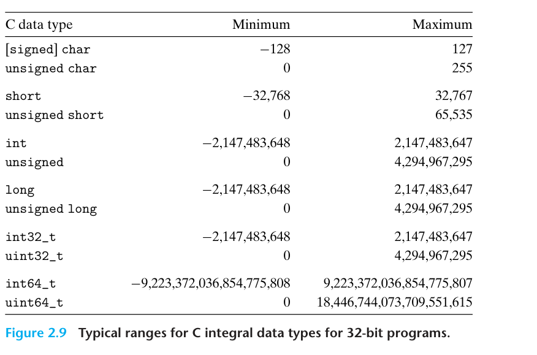
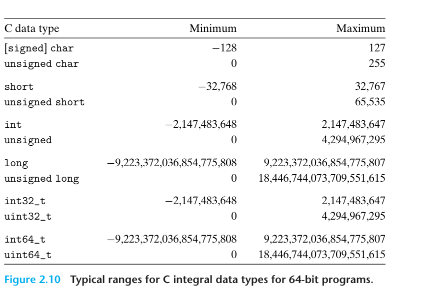

#+title:      chapter2-representing-and-manipulating-information
#+date:       [2026-10-04 Sun 21:21]
#+filetags:   :csapp:
#+identifier: 20261004T212128

* Representing and Manipulating Information

主线:

数据表示 -> 机器级指令 -> 编译 -> 处理器 -> 性能 -> 存储器。

重点是理解 *C程序最终如何在真实机器上被表示和执行* 。

* Information Storage

误删除，等待后续补充

* Integer Representations

整数表示。本节将介绍计算机如何使用不同的 bit pattern 表示整数，包括无符号整数(unsigned integer) 、补码整数(two's-complement integer) 以及不同位宽之间的转换。

| 符号      | 类型 | 含义         |
|----------+-----+-------------|
| $B2T_w$  | 函数 | 二进制到补码  |
| $B2U_w$  | 函数 | 二进制到无符号 |
| $U2B_w$  | 函数 | 无符号到二进制 |
| $U2T_w$  | 函数 | 无符号到补码  |
| $T2B_w$  | 函数 | 补码到二进制  |
| $T2U_w$  | 函数 | 补码到无符号  |
| $TMin_w$ | 常量 | 补码最小值    |
| $TMax_w$ | 常量 | 补码最大值    |
| $UMax_w$ | 常量 | 无符号最大值  |
| $+_w^t$  | 运算 | 补码加法      |
| $+_w^u$  | 运算 | 无符号加法    |
| $*_w^t$  | 运算 | 补码乘法      |
| $*_w^u$  | 运算 | 无符号乘法    |
| $-_w^t$  | 运算 | 补码取负      |
| $-_w^u$  | 运算 | 无符号取负    |

下标 $w$ 代表数据表示形式所使用的位数。

** Integral Data Types

整数数据类型。

C语言支持多种整型数据类型，这些类型所表示的整数都有有限的取值范围。

比如32位程序中的典型整型结构:

64位程序中的典型整型范围:

图中唯一随机器而变化的取值范围，是由大小修饰符 ~long~ 指定的类型。大多数64位程序使用8字节来表示 ~long~, 而32位程序采用4字节。

注意到这些数值范围并不对称：负数的取值范围比正数多出一个数值。

因为例如对于32位 ~int~:

最小值=$-2^31$

最大值=$2^31-1$

负数一侧比整数一侧多处一个可表示的数值。

** Unsigned Encodings

无符号数编码。

这一小节开始建立无符号整数的数学意义。

考虑一个具有 $w$ 位的整型数据类型。我们用 $\vec{x}$ 表示一个完整的位向量(bit vector) ，或者写成:

$$
\vec{x} = [x_{w-1}, x_{w-2}, ..., x_0]
$$

以表示该向量中的各个位。

如果将 $\vec{x}$ 看作一个用二进制记数法写出的数，我们就得到了 $\vec{x}$ 的无符号解释(unsigned interpretation).

在这种编码方式中，每一位 $x_i$ 的值都是0或1, 如果它的值为1, 那么就意味着在该数的数值中应当包含 $2^i$ 这一项。

我们可以使用函数 $B2U_w$ (binary to unsigned, 长度为 w) 来表达这种解释。

我们定义:

$$
\boxed{B2U_w(\vec{x})\doteq\sum_{i=0}^{w-1}x_i2^i}
$$

在这个公式中，符号 $\doteq$ 表示左边被定义为等于右边。函数 $B2U_w$ 将长度为 $w$ 的、由0和1组成的位串映射到非负整数。

比如，下面的公式展示了函数 $B2U_w$ 如何将位向量映射到整数：

\begin{align*}
B2U_4([0001])
&=0\cdot2^3+0\cdot2^2+0\cdot2^1+1\cdot2^0\\
&=0+0+0+1=1\\
B2U_4([0101])
&=0\cdot2^3+1\cdot2^2+0\cdot2^1+1\cdot2^0\\
&=0+4+0+1=5
\end{align*}

