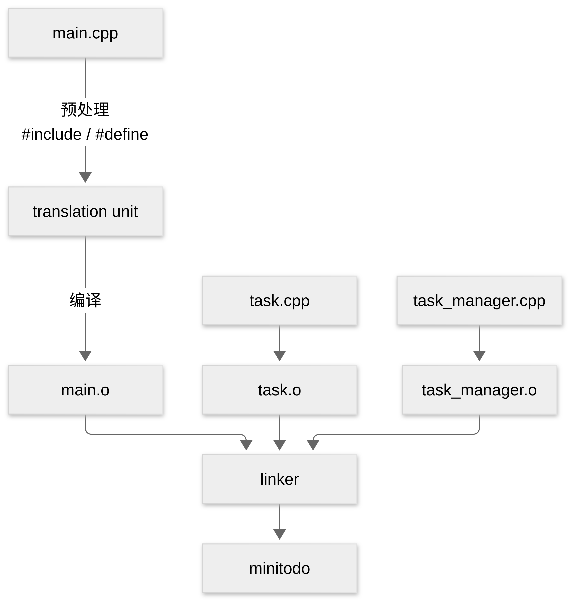
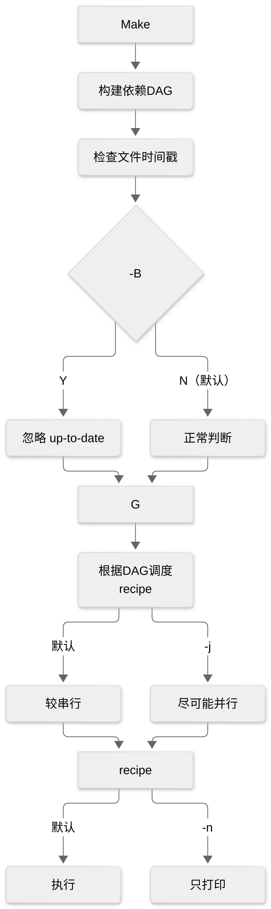

#+title:      make基础
#+date:       [2026-09-16 Wed 23:00]
#+filetags:   :buildsystem:
#+identifier: 20260916T230010
* Make

make 在维护一张依赖图:

#+begin_example
source/header
|
| compile
|
object file
|
| link
|
executable
#+end_example

C++ 构建过程是：

所以 Makefile 里的:

#+begin_src Makefile
  $(OBJ_DIR)/%.o: %.cpp
                  $(CXX) ... -c $< -o $@
#+end_src

是在描述:

#+begin_example
.cpp --compile--> .o
#+end_example

而:

#+begin_src makefile
  $(TARGET): $(OBJECTS)
  	$(CXX) $^ -o $@
#+end_src

是在描述:

#+begin_example
.o + .o + .o --link--> executable
#+end_example

这两条规则就是当前 Makefile 的骨架:

#+begin_src makefile
  CXX := g++
  CPPFLAGS := -Iinclude
  CXXFLAGS := -std=c++23 -Wextra -Wall -Wpedantic

  SRC_DIR := src
  APP_DIR := app
  BUILD_DIR := build
  OBJ_DIR := $(BUILD_DIR)/obj
  BIN_DIR := $(BUILD_DIR)/bin
  TARGET := $(BIN_DIR)/minitodo

  SOURCES := $(wildcard $(SRC_DIR)/*.cpp) $(wildcard $(APP_DIR)/*.cpp)
  OBJECTS := $(patsubst %.cpp,$(OBJ_DIR)/%.o,$(SOURCES))

  .PHONY: all clean

  all: $(TARGET)

  $(TARGET): $(OBJECTS)
  	@mkdir -p $(dir $@)
  	$(CXX) $^ -o %@

  $(OBJ_DIR)/%.o: %.cpp
  	@mkdir -p $(dir $@)
  	$(CXX) $(CPPFLAGS) $(CXXFLAGS) -c $< -o $@

  clean:
  	rm -rf $(BUILD_DIR)
#+end_src

* GCC/G++ 的常见选项

~-MMD~ 和 ~-MP~: 帮助make自动维护头文件依赖。

** ~-MMD~

~-MMD~ 的作用是，编译 ~.cpp~ 的同时，额外生成一个 ~.d~ 的依赖文件。例如:

#+begin_src bash
  g++ -MMD -c src/task.cpp -o build/task.o
#+end_src

假设 ~task.cpp~:

#+begin_src cpp
  #include "task.hpp"
  #include "utils.hpp"
#+end_src

那么除了要生成 ~build/taks.o~ 之外，还会生成 ~build.task.d~ 。内容大致是:

#+begin_src makefile
  build/task.o: src/task.cpp include/task.hpp include/utils.hpp
#+end_src

其实就是一条 Makefile 规则。于是在 Makefile 中，当你使用 ~-include $(DEPS)~ 将依赖 ~.d~ 文件读进来之后，make就知道 task.o 依赖 task.cpp, task.hpp, utils.hpp ，所以以后即便只修改了这里的头文件，make 仍然会发现头文件比 task.o 新，于是触发重新构建。

~-MMD~ 还有一个特点是：只记录“用户头文件”，不记录系统头文件。而比如 ~-MD~ 会记录系统头文件。一般使用 ~-MMD~, 因为没必要让系统头文件的变化也进入到项目依赖图中。

** ~-MP~

~-MP~ 则是在 ~.d~ 文件里额外为每个头文件生成一个空规则，比如:

#+begin_src makefile
  build/task.o: src/task.cpp include/task.hpp include/utils.hpp

  include/task.hpp:
  include/utlis.hpp:
#+end_src

后面两个空的规则就是 ~-MP~ 加进去的。它们之后 Target, 没有 prerequisite, 也没有 recipe. 主要作用就是防止“删除头文件后make直接报错”。

比如，假如之前写了 ~old.hpp~, 并且也依赖了 ~#include "old.hpp"~, 但是今天重构代码，把这两个删除了。而旧的 task.d 中仍然存在，里面仍然写着:

#+begin_src makefile
  task.o: task.cpp old.hpp
#+end_src

当下一次执行make时，就会看到 ~old.hpp~ 已经不存在了，但是仍然被依赖。于是就有可能报错:

#+begin_example
make: *** No rule to make target 'old.hpp', needed by 'task.o'. Stop.
#+end_example

而 ~-MP~ 会直接在 ~.d~ 的文件里就写一个空的规则，于是make就不会因为找不到文件而立即终止。空的规则相当于告诉make ~old.hpp~ 这个target是有规则的，只不过规则为空。然后make就会正常执行， ~task.cpp~ 会重新编译，新的 ~.d~ 也会随之覆盖旧依赖。

* Make 的常见选项

我们先来看 ~-n~, ~-B~, ~-j~:

- ~-n~: 要不要执行recipe
- ~-B~: 要不要相信时间判断
- ~-j~: 允许同时执行多少个 recipe

** ~-n~

~make -n~ 的含义是:

#+begin_quote
Make 能正常分析依赖图、检查时间戳、选择规则、展开变量，但最终并不执行recipe
#+end_quote

这里要做一个区分：

- Make的“思考”：
  - 分析DAG
  - 检查 prerequisites
  - 比较 mtime
  - 寻找 pattern rule
  - 展开 $@ $< $^
  - 决定哪些 recipe 要执行
- Make的“行动”：
  - 把 recipe 交给 shell

而 ~-n~ 基本上只关闭第二部分。

** ~-B~

正常情况下，make会依赖系统时间戳来判断是否需要重新构建某些目标，而 ~-B~ 的含义可以近似理解为： _从当前的 target 开始，强制走所有的构建过程_ 。这个过程会重新链接，同时也会重新编译所有的 ~.o~ 文件，不再关注时间戳的新旧。

注意与 ~clean~ 的区分，它是直接删除构建文件。而 ~-B~ 是不相信“目标已经 up to date”的判断，重新构建，目标和构建产物其实都还存在。

** ~-j~

我们的构建过程看起来像是:

#+begin_example
compile main.cpp
|
compile task.cpp
|
compile task_manager.cpp
|
link minitodo
#+end_example

但从DAG上看，我们的三个 ~.o~ 之间并没有依赖关系。所以在理论上，三个 ~.o~ 文件可以同时构建。这就是 ~make -j~ 可以利用的东西。但是，make并不能在 ~.o~ 还没构建好的时候就去link target, 因为在规则里有明确的依赖关系，target 必须等待三个 ~.o~ 都构建完成后才能 link.

所以对于 ~make -j~ 的理解更确切的是：

#+begin_quote
Make 根据依赖 DAG, 尽可能同时调度当前已经满足 prerequisite 条件的目标。
#+end_quote

日常中更常见的是 ~make -j8~ 或者 ~make -j$(nproc)~, ~nproc~ 会返回可用的CPU数量。

总结起来就是如图:

* 学习小笔记

1. ~%~ 是 stem，并非通配搜索
2. ~wildcard~, ~patsubst~ 和 pattern rule 是不同阶段
   1. ~SOURCES := $(wildcard ...)~ 和 ~OBJECTS := $(patsubst...)~ 是在构建文件名列表
   2. 而 ~$(OBJ_DIR)/$.o: %.cpp~ 是在描述构建规则。
3. Make 决定“是否执行”，编译器决定“如何编译”
   1. Make 负责 DAG, mtime, prerequisite, target 和 recipe 调度
   2. 编译器(g++)负责 预处理，编译，汇编，链接
4. ~.d~ 是编译器和Make之间的桥梁。Make本身并不会自动解析头文件导入，但是编译器会。于是只有通过 ~-MMD~ 生成 ~.d~ 文件，才能让Make感知到头文件的变化。而 ~-MP~ 则主要解决旧的 ~.d~ 仍然提到已经删除的头文件的问题。
5. ~-n~, ~-B~, ~-j~ 操纵的是三个不同层面

