#+title: Python 多线程

* Event
以下面这段代码为例:

#+begin_src python
  import threading
  import time

  initialized = threading.Event()

  def initialize():
      print("Initializing...")
      time.sleep(2)
      initialized.set()

  thread = threading.Thread(target=initialize)
  thread.start()

  if initialized.wait(timeout=5):
      print("Initialization finished")
  else:
      print("Initialization timeout")
#+end_src

1. ~initialized~ 是一个 Event 实例对象, 内部维护一个初始为 False 的标志。调用 ~wait()~ 的线程会在标志位为 False 时等待，所以 **Event 是用于线程同步的对象， wait() 会让调用它的线程阻塞** 。 Event 本身不是一个线程
2. 这里主线程启动后台线程后，调用 ~initialized.wait(timeout=5)~ 。后台线程执行 ~initialized()~, 两秒后调用 ~set()~, 将标志设为 True, 唤醒在这个 ~Event~ 上的线程。主线程的 ~wait()~ 返回 True, 打印完成信息。

可以这样理解 ~initialize~ 和 ~thread~: ~initialize~ 是一份要做的工作， ~thread~ 是一个负责执行这份工作的线程对象，而 ~initialized~ 是工作完成后用来通知别人的信号。

- ~initialize~: 函数，描述初始化要执行哪些语句
- ~thread~: ~Thread~ 实例，代表并管理一个独立的执行线程。它保存了目标函数等配置，还提供 ~start()~, ~join()~ 等方法。
- ~initialized~: ~Event~ 实例，用来协调线程之间的等待和通知。

- ~set()~: 将内部标志为置为 True, 并唤醒等待该事件的线程
- ~clear()~: 将标志位置为 False
- ~wait()~: 在标志位为 False 的时候等待；标志位为 True 的时候可以继续执行

但是 Event 能传递通知，却不能自动保证一个复杂操作的正确性。

比如后台任务正在执行:

#+begin_src python
  def worker():
      while not cancel_event.is_set():
          do_some_work()
#+end_src

主线程执行:

#+begin_src python
  cancel_event.set()
#+end_src

只是发出了一个取消请求。 ~set()~ 不会强行终止已经运行到线程，也不会中断任意阻塞调用。

* 线程执行模型、竞争条件与 Lock

- 执行模型：线程如何启动、运行、阻塞、恢复、结束
- 共享状态: 多个线程如何访问同一个 Python 对象，何时发生数据竞争
- 同步机制: 如何用 ~Lock~, ~Event~, ~Condition~ 等工具建立正确的执行顺序

我们这次的核心区别是:

- cancel requested: 取消请求。有人希望任务停止，但任务仍然可能进行
- CANCELLED: 任务已经确认取消，并进入了终态

这两个概念不能混为一谈。类似的， ~join()~ 等待线程结束，但并不会发出取消请求。

** 实验一: 取消请求发生在完成之前

假设我们正在开发一个后台执行器，它有三个终态:

#+begin_export ascii
                     ┌──▶ SUCCEEDED
CREATED ──▶ RUNNING ─┼──▶ FAILED
                     └──▶ CANCELLED
#+end_export

约定两个规则:

1. 终态不可逆。一旦任务进入 ~SUCCEEDED~, ~FAILED~ 或 ~CANCELLED~, 任何线程都不能再次改变其状态
2. 取消与完成需要有明确的先后判定。如果取消请求被正式受理，任务最终应该进入 ~CANCELLED~ ；如果任务先提交成功，之后的取消请求无效

#+begin_src python :results output
  from threading import Event, Thread

  cancel_requested = Event()
  cancel_checked = Event()
  finish_gate = Event()

  state = {"value": "RUNNING"}

  def worker():
      # A: 检查是否收到取消请求
      if cancel_requested.is_set():
          state["value"] = "CANCELLED"
          return

      # B: 告诉主线程已经检查过状态
      cancel_checked.set()

      # C: 等待主线程允许提交结果
      if not finish_gate.wait(timeout=3):
          state["value"] = "FAILED"
          return

      # D: 提交成功状态
      state["value"] = "SUCCEEDED"

  thread = Thread(target=worker, name="task-worker")
  thread.start()

  assert cancel_checked.wait(timeout=3)

  cancel_requested.set()

  finish_gate.set()

  thread.join(timeout=3)
  assert not thread.is_alive()

  print("state =", state["value"])
  print("cancel requested =", cancel_requested.is_set())
#+end_src

#+RESULTS:
: state = SUCCEEDED
: cancel requested = True

** 为什么需要 Lock

考虑:

#+begin_src python
  if not cancel_requested.is_set():
      state["value"] = "SUCCEEDED"
#+end_src

这里包含两个逻辑操作：读取标志，以及修改任务状态。线程可以在这两个操作之间切换执行。我们不能假设这两个操作构成不可分割的整体。

~Lock~ 可以将一组操作组织成互斥执行的临界区:

#+begin_src python
  from threading import Lock

  lock = Lock()

  with Lock:
      # 需要共同保护的状态检查和修改
      ...
#+end_src

~Lock~ 提供两个基本操作:

- ~acquire()~: 尝试获取锁。已被占用时，默认阻塞等待
- ~release()~: 释放锁。允许等待者竞争获取

通常使用 ~with lock~ 管理获取和释放。例如:

#+begin_src python
  with lock:
      if state == "RUNNING":
          state == "SUCCEDDED"
#+end_src

当某个线程执行这个代码块时，其他需要获取同一把锁的线程必须等待。

这里我们引入一个概念: **Invariant(不变量)**: 指的是程序在约定的观察行为或操作边界上必须一直满足的性质

** 实验二: 状态管理器

#+begin_src python :results output
  from threading import Lock, Event, Thread

  class Task:
      def __init__(self):
          self._lock = Lock()
          self._cancel_requested = Event()
          self._state = "RUNNING"

      def cancel(self):
          with self._lock:
              if self._state != "RUNNING":
                  return False

              self._cancel_requested.set()
              return True

      def finish(self):
          with self._lock:
              if self._state != "RUNNING":
                  return

              if self._cancel_requested.is_set():
                  self._state = "CANCELLED"
              else:
                  self._state = "SUCCEEDED"

      def snapshot(self):
          with self._lock:
              return (
                  self._state,
                  self._cancel_requested.is_set()
              )

  task = Task()

  ready = Event()
  finish_gate = Event()

  def worker():
      ready.set()
      finish_gate.wait()
      task.finish()

  thread = Thread(target=worker)
  thread.start()

  assert ready.wait(timeout=5000)

  assert task.cancel() is True

  finish_gate.set()

  thread.join(timeout=3)
  assert not thread.is_alive()

  print(task.snapshot())

  task2 = Task()
  task2.finish()
  print(task2.cancel())
  print(task2.snapshot())
#+end_src

#+RESULTS:
: ('CANCELLED', True)
: False
: ('SUCCEEDED', False)

** 实验三: 一个竞态Bug

#+begin_src python :results output
  from threading import Thread, Barrier, Lock

  def run(use_lock):
      value = [0]
      both_ready = Barrier(2)
      lock = Lock()

      def increament():
          if use_lock:
              both_ready.wait(timeout=3)

              with lock:
                  before = value[0]
                  value[0] = before + 1
          else:
              before = value[0]
              both_ready.wait(timeout=3)
              value[0] = before + 1
      threads = [
          Thread(target=increament, name=f"worker-{i}")
          for i in (1, 2)
      ]

      for thread in threads:
          thread.start()

      for thread in threads:
          thread.join(timeout=3)
          assert not thread.is_alive()
      return value[0]

  print("without Lock:", run(False))
  print("with Lock:", run(True))
#+end_src

#+RESULTS:
: without Lock: 1
: with Lock: 2

** 实验四: 多线程实践

下面有一个有Bug的程序:

#+begin_src python :results output
  from threading import Thread, Lock, Barrier

  class Account:
      def __init__(self, balance):
          self._balance = balance
          self._lock = Lock()

      def withdraw_unsafe(self, amount, barrier):
          """故意存在竞态条件的版本"""
          if self._balance < amount:
              return False

          old_balance = self._balance

          # 保证两个线程都读取完余额才继续
          barrier.wait(timeout=3)

          self._balance = old_balance - amount
          return True

      def withdraw(self, amount):
          """TODO 1: 实现线程安全的取款"""
          # 余额不足返回 False
          # 否则扣除金额并返回 True
          with self._lock:
              if self._balance < amount:
                  return False
              self._balance -= amount
              return True
          

      def deposit(self, amount):
          """TODO 2: 实现线程安全的存款"""
          with self._lock:
              if (amount < 0):
                  return False
              self._balance += amount
          return True

      def get_balance(self):
          """TODO 3: 安全地读取当前余额"""
          with self._lock:
              return self._balance

  def run_two_threads(action):
      results = [None, None]

      def worker(index):
          results[index] = action()

      threads = [
          Thread(target=worker, args=(i,))
          for i in range(2)
      ]

      for thread in threads:
          thread.start()

      for thread in threads:
          thread.join(timeout=3)
          assert not thread.is_alive()

      return results

  if __name__ == "__main__":
      # 实验一：错误实现
      account = Account(100)
      barrier = Barrier(2)

      results = run_two_threads(
          lambda: account.withdraw_unsafe(80, barrier)
      )

      print("Unsafe results:", results)
      print("Unsafe balance:", account._balance)

      # 实验二：等待你实现的安全版本
      account = Account(100)

      results = run_two_threads(
          lambda: account.withdraw(80)
      )

      print("Safe results:", results)
      print("Safe balance:", account.get_balance())

      assert results.count(True) == 1
      assert results.count(False) == 1
      assert account.get_balance() == 20

      account.deposit(30)
      assert account.get_balance() == 50

      print("All tests passed!")
#+end_src

#+RESULTS:
: Unsafe results: [True, True]
: Unsafe balance: 20
: Safe results: [True, False]
: Safe balance: 20
: All tests passed!

关于这三个操作，我们可以理解为：

#+begin_quote
多个线程可以同时调用这些方法，但它们不能同时执行由同一把 Lock 保护的临界区。
#+end_quote

~Lock~ 只能锁住那些主动获取同一把锁的代码。它的粒度是很细的。比如我们这里如果 ~withdraw_unsafe()~ 与 ~withdraw()~ 同时进行，前者仍然可以在后者的临界区内修改 ~_balance~ 。想要维护账户不变量，所有访问这份共享状态的代码都必须遵守同步协议。
** 实验五: Task Runner

这次练习我们开始真正使用 Lock：单任务状态管理与协作式取消

一个 ~TaskState~ 对象有两份共享状态：

#+begin_src python
  self._state = "RUNNING"
  self._cancel_requested = Event()
#+end_src

其含义是:

1. ~_state~ 表示任务的当前执行状态
2. ~_cancel_requested~ 表示是否已接受取消请求

我们规定: 如果 ~cancel()~ 先受理，之后 ~finish()~ 应提交 ~CANCELLED~ ；如果 ~finish()~ 先提交 ~SUCCEEDED~, 之后的 ~cancel()~ 应返回 ~False~

需要完成下面三个方法:

#+begin_src python
  from threading import Lock, Event

  class TaskState:
      def __init__(self):
          self._lock = Lock()
          self._state = "RUNNING"
          self._cancel_requested = Event()

      def cancel(self):
          """
          请求取消任务

          如果任务正在进行，并且尚未请求取消:
            接受请求，返回 True

          如果任务已结束或已请求过取消：
            返回 False
          """
          # TODO
          pass

      def finish(self):
          """
          提交最终状态

          如果已经请求取消：
            状态变成 CANCELLED

          否则:
            状态变成 SUCCEEDED

          已经处于终态时，不能再次修改
          """

          # TODO
          pass

      def snapshot(self):
          """
          返回：
            (state, cancel_requested)

          要求读到一致的状态快照
          """
          # TODO
          pass

  if __name__ == "__main__":
      # 测试一：正常完成
      task = TaskState()
      task.finish()

      assert task.snapshot() == ("SUCCEEDED", False)
      assert task.cancel() is False

      # 测试二：取消任务
      task = TaskState()
      assert task.cancel() is True
      assert task.cancel() is False

      task.finish()

      assert task.snapshot() == ("CANCELLED", True)

      # 测试三：终态不可逆
      task.finish()
      assert task.snapshot() == ("CANCELLED", True)
      print("All test passed!")
#+end_src
