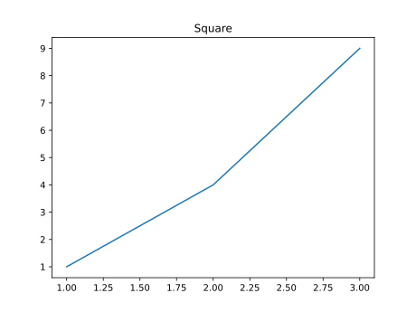

#+title:      lesson1
#+date:       [2026-10-03 Sat 15:46]
#+filetags:   :matplotlib:
#+identifier: 20261003T154646

* Matplotlib: Figure, Axes, Axis, Artist

先看最小程序:

#+name: simplest example
#+begin_src python :results output file graphics :file figure/simplest-example.svg
  import matplotlib.pyplot as plt

  fig, ax = plt.subplots()
  ax.plot([1, 2, 3], [1, 4, 9])

  ax.set_title("Square")
#+end_src

#+RESULTS: simplest example

* ~matplotlib~

~matplotlib~ 是整个 Python 绘图库的包名。通常不会直接从顶层 ~matplotlib~ 开始绘图，而是使用它的一个模块 : ~matplotlib.pyplot~ . 可以暂时把包结构理解为:

#+begin_export ascii
matplotlib
├── pyplot
├── figure
├── axes
├── axis
├── artist
├── lines
├── text
├── patches
└── ...
#+end_export

Matplotlib 实际上是一套相当完整的图形对象系统。

* ~pyplot~

这是一套方便操作 Figure 和 Axes 的接口。它还维护了“当前Figure/当前Axes”这样的状态。更推荐使用对象式写法:

#+begin_src python
  fig, ax = plt.subplots()
  ax.plot(x, y)
  ax.set_title("hello")
  ax.set_xlabel("x")
#+end_src

* ~Figure~

~figure~ 是整张图的最外层容器。可以理解为:

#+begin_export ascii
┌───────────────────────────────────────┐
│               Figure                  │
│                                       │
│      ┌───────────────────────┐        │
│      │                       │        │
│      │         Axes          │        │
│      │                       │        │
│      └───────────────────────┘        │
│                                       │
└───────────────────────────────────────┘
#+end_export

可以粗略理解 Figure 就是一张画布。但严格来说，Matplotlib 内部真正负责渲染的是 ~FigureCanvans~, 所以“画布”是一种方便的比喻。

#+name: type of Figure
#+begin_src python :results output
  import matplotlib.pyplot as plt

  fig = plt.figure()
  print(type(fig))
#+end_src

#+RESULTS: type of Figure
: <class 'matplotlib.figure.Figure'>

可以看到 ~plt.figure()~ 的类型是 ~matplotlib.figure.Figure~

* ~Axes~

~Axes~ 表示一块完整的绘图区域。也就是我们口语中常说的“这个图表”、“这个坐标系”。 ~Axes~ 是进行图表可视化的主要入口，绝大多数的绘图操作最终都是发生在 Axes 上的。

例如， Axes 可能包括:

#+begin_export ascii
Figure
│
└── Axes
    ├── x 方向
    ├── y 方向
    ├── 数据曲线
    ├── title
    ├── xlabel
    ├── ylabel
    ├── legend
    └── ...
#+end_export

所以 ~fig, ax = plt.subplots()~ 中的 ~ax~ 就是一个 ~matplotlib.axes.Axes~ 对象。

** ~Axes~ 和 ~Axis~

~Axes~ 通常指整块绘图区， ~Axis~ 指某一个坐标方向。一个普通的二维 ~Axes~ 中一般包含 ~XAxis~ 和 ~YAxis~ .

#+name: Axes and Axis
#+begin_src python :results output
  import matplotlib.pyplot as plt

  fig, ax = plt.subplots()

  print(type(ax))
  print(type(ax.xaxis))
  print(type(ax.yaxis))
#+end_src

#+RESULTS: Axes and Axis
: <class 'matplotlib.axes._axes.Axes'>
: <class 'matplotlib.axis.XAxis'>
: <class 'matplotlib.axis.YAxis'>

可以从上面的内容查看类型。

* ~subplots~

意思是一张Figure里的一个子绘图区。 ~plt.subplots()~ 会同时做两件事情:

- 创建 Figure
- 在 Figure 中创建 Axes

然后把这两个对象返回。比如:

#+name: return object from subplot
#+begin_src python :results output
  import matplotlib.pyplot as plt

  result = plt.subplots()

  print(type(result))

  for item in result:
      print(type(item))
      print(item)

  print(result)
#+end_src

#+RESULTS: return object from subplot
: <class 'tuple'>
: <class 'matplotlib.figure.Figure'>
: Figure(640x480)
: <class 'matplotlib.axes._axes.Axes'>
: Axes(0.125,0.11;0.775x0.77)
: (<Figure size 640x480 with 1 Axes>, <Axes: >)

- ~plt.subplots()~ 的返回值是一个 tuple
- 这个 tuple 中包含两个对象:
  - 第一个是 ~Figure~ 类型的对象，带有默认的尺寸
  - 第二个是 ~Axes~ 类型的对象，带有默认的位置和尺寸

* ~plot~

在 ~ax.plot([1, 2, 3], [1, 4, 9])~ 里面， ~plot~ 的意思是“绘制，标绘”。这里传递的是一组坐标: ~x = [1, 2, 3]~, ~y = [1, 4, 9]~ ，

所以对应的点就是 ~(1, 1), (2, 4), (3, 9)~ ，然后 Matplotlib 就会把这些点用线连接起来。

#+name return object of ax.plot
#+begin_src python :results output
  import matplotlib.pyplot as plt

  fig, ax = plt.subplots()

  lines = ax.plot(
      [1, 2, 3],
      [1, 4, 9]
  )

  print(type(lines))

  print(f"length of lines: {len(lines)}")

  print("Item in lines:")
  for line in lines:
      print(line)

  print(lines)
#+end_src

#+RESULTS:
: <class 'list'>
: length of lines: 1
: Item in lines:
: Line2D(_child0)
: [<matplotlib.lines.Line2D object at 0x7f67e1d281a0>]

可以看到， ~plot()~ 返回的是一个 list, 里面包含了一个 ~matplotlib.lines.Line2D~ 的对象。

* ~Artists~

所有能够被绘制出来的图形对象都是 ~Artists~ . 几乎所有能够在 Matplotlib Figure 上看到的对象都是 ~Artists~, 例如:

#+begin_export ascii
Artist
├── Figure
├── Axes
├── Axis
├── Line2D
├── Text
├── Rectangle
├── Legend
├── Tick
└── ...
#+end_export

例如 ~ax.plot(x, y)~ 会创建 ~Line2D Artists~, 而 ~ax.set_title("Hello")~ 会创建 ~Text Artists~.

~plot~ 会创建 ~Line2D~, ~text~ 会创建 ~Text~, ~bar~ 会创建 ~Rectangle~, ~imshow~ 会创建 ~AxesImage~

我们可以查看一下 ~Artists~ 树:

#+name artist tree
#+begin_src python :results output
  import matplotlib.pyplot as plt

  fig, ax = plt.subplots()

  lines = ax.plot(
      [1, 2, 3],
      [1, 4, 9]
  )

  ax.set_title("Square")

  for child in ax.get_children():
      print(type(child))
#+end_src

#+RESULTS:
#+begin_example
<class 'matplotlib.lines.Line2D'>
<class 'matplotlib.spines.Spine'>
<class 'matplotlib.spines.Spine'>
<class 'matplotlib.spines.Spine'>
<class 'matplotlib.spines.Spine'>
<class 'matplotlib.axis.XAxis'>
<class 'matplotlib.axis.YAxis'>
<class 'matplotlib.text.Text'>
<class 'matplotlib.text.Text'>
<class 'matplotlib.text.Text'>
<class 'matplotlib.patches.Rectangle'>
#+end_example

可以看到一个简单的折线图里包含大量的对象。

* 小结

| 单词      | Matplotlib中的意思      |
|-----------+-------------------------|
| ~Figure~  | 整张图的最外层容器       |
| ~Axes~    | 一整块绘图区             |
| ~Axis~    | 一个坐标方向，例如 XAxis |
| ~Artists~ | 可以被绘制的图形对象     |
