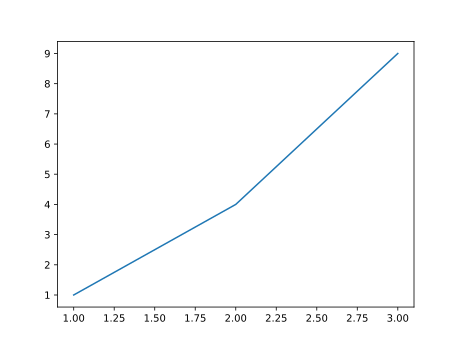
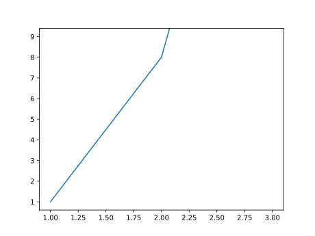
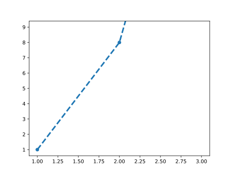
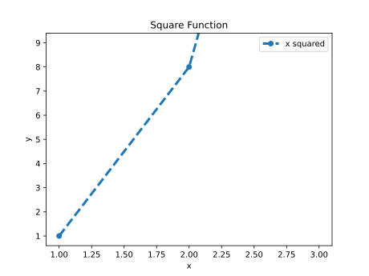
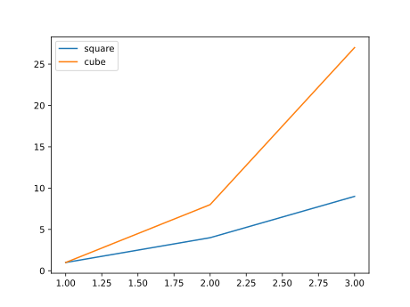

#+title:      lesson2
#+date:       [2026-10-03 Sat 16:36]
#+filetags:   :matplotlib:
#+identifier: 20261003T163601
* 操纵 ~Line2D~ 对象

首先我们初始化
#+name: make-line
#+begin_src python :session plot :results silent
  import matplotlib.pyplot as plt

  plt.close("all")

  fig, ax = plt.subplots()

  line, = ax.plot(
      [1, 2, 3],
      [1, 4, 9]
  )
#+end_src

然后我们查看这个 ~line~ 的类型
#+name: type of plot() return value
#+begin_src python :session plot :results output
  print(type(line))
#+end_src

#+RESULTS: type of plot() return value
: <class 'matplotlib.lines.Line2D'>

#+begin_src python :session plot :results value file graphics :file figure/line.svg
fig
#+end_src

#+RESULTS:

* ~line, = ...~

这里为什么要这样写？因为 ~ax.plot()~ 返回的是一个列表，只有一个元素。所以可以写:

#+begin_src python
  lines = ax.plot(...)
  line = lines[0]
#+end_src

或者可以利用 python 解包:

#+begin_src python
  line, = ax.plot(...)
#+end_src

逗号表示的是右边必须恰好有一个元素，然后把这个元素赋值给 ~line~

* 读取这条线的数据

~line~ 是对象，那我们就可以读取它的数据:

#+name: read line
#+begin_src python :session plot :results output
  print(line.get_xdata())
  print(line.get_ydata())
#+end_src

#+RESULTS: read line
: [1 2 3]
: [1 4 9]

这说明 matplotlib 中数据会以对象的形式长期存在

* 修改已经存在的线

既然 ~line~ 是一个对象，我们当然也可以修改它的值。比如:

#+name: modify line
#+begin_src python :session plot :results output
  line.set_ydata([1, 8, 27])
  print(line.get_ydata())
#+end_src

#+RESULTS: modify line
: [1, 8, 27]

#+name: modify line figure
#+begin_src python :session plot :results value file graphics :file figure/line_modified.svg
  fig
#+end_src

#+RESULTS: modify line figure

可以看到, ~line~ 的 ~ydata~ 也就是纵坐标被修改了，同时绘制图形的折线也被修改了。注意这里并没有通过 ~ax.plot()~ 重新绘制，只是修改原来的 ~Line2D~ 对象。

* 修改线的视觉属性

#+begin_src python :session plot :results value file graphics :file figure/line_sight_modified.svg
  line.set_linewidth(3) # 设置线宽
  line.set_linestyle("--") # 设置为虚线
  line.set_marker("o") #  给数据点添加 marker
  fig
#+end_src

#+RESULTS:

可以看到 ~Line2D~ 会按照我们希望的进行调整。

* ~get_*~ 和 ~set_*~

这是 Matplotlib 很典型的一种API风格:

#+begin_src python
  line.get_xdata()
  line.get_ydata()

  line.set_xdata(...)
  line.set_ydata(...)

  line.get_linewidth()
  line.set_linewidth(...)

  line.get_linestyle()
  line.set_linestyle(...)
#+end_src

其实就是 ~getter~ 和 ~setter~

* 创建时指定

也可以在把上面后来重设的内容，在创建时就指定:

#+begin_src python
  line, = ax.plot(
      x,
      y,
      linewidth=3,
      linestyle="--",
      marker="o"
  )
#+end_src

本质上表达的是类似的事情，区别是修改发生的时间不同。

* ~label~

我们可以这样写:

#+begin_src python :session plot :results value file graphics :file figure/line_with_label.svg
  line.set_label("x squared")
  fig
#+end_src

#+RESULTS:

我们会看到出现了一个图例

* ~Axe~ 也可以操作

~ax~ 也是一个普通的 Python 对象。于是我们同样可以:

#+name: modify ax
#+begin_src python :session plot :results output
  ax.set_title("Square Function")
  ax.set_xlabel("x")
  ax.set_ylabel("y")

  print(ax.get_title())
  print(ax.get_xlabel())
  print(ax.get_ylabel())
#+end_src

#+RESULTS: modify ax
: Square Function
: x
: y

#+name modify ax fig
#+begin_src python :session plot :results value file graphics :file figure/line_ax_modifed.svg
  fig
#+end_src

#+RESULTS:

可以看到，这里出现了横纵坐标的名字和整个图像的名字。

* 两条线

接下来我们创建两条线

#+begin_src python :session twolines :results silent
  import matplotlib.pyplot as plt

  fig, ax = plt.subplots()

  line1, = ax.plot(
      [1, 2, 3],
      [1, 4, 9],
      label="square"
  )

  line2, = ax.plot(
      [1, 2, 3],
      [1, 8, 27],
      label="cube"
  )
#+end_src

然后我们观察:

#+name: ax.lines
#+begin_src python :session twolines :results output
  print(ax.lines)
  for line in ax.lines:
      print(f"{line.get_label()}:\n\tx: {line.get_xdata()}\n\ty: {line.get_ydata()}")
#+end_src

#+RESULTS: ax.lines
: <Axes.ArtistList of 2 lines>
: square:
: 	x: [1 2 3]
: 	y: [1 4 9]
: cube:
: 	x: [1 2 3]
: 	y: [ 1  8 27]

可以看到现在 ~ax.lines~ 有两个元素，分别是我们创建的两条线。

#+name: 2lines figure
#+begin_src python :session twolines :results value file graphics :file figure/2-lines.svg
  ax.legend() # 显示线的图例
  fig
#+end_src

#+RESULTS: 2lines figure

