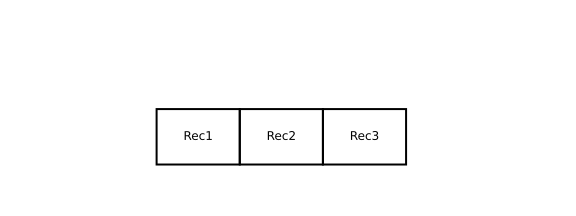

#+title:      lesson3
#+date:       [2026-10-03 Sat 19:51]
#+filetags:   :matplotlib:
#+identifier: 20261003T195111
* Lesson3

最常用的是这几类函数:

1. ~ax.text(...)~: 放文字
2. ~Rectangle~: 画矩形
3. ~ax.add_patch(...)~: 将一个图形对象加入画布
4. ~ax.plot(...)~: 画直线段
5. ~ax.annotate(...)~: 画箭头+文字
6. ~ax.set_xlim()~ / ~ax.set_ylim()~: 决定画布范围
7. ~ax.set_aspect('equal')~: 让 x/y 的比例一致
8. ~ax.axis('off')~: 隐藏坐标轴

* 简单分层架构图

#+begin_src python :results output file graphics :file figure/architecture_simple.svg
  import matplotlib.pyplot as plt
  from matplotlib.patches import Rectangle

  fig, ax = plt.subplots(figsize=(10, 3))

  # 设定画布范围
  ax.set_xlim(0, 12)
  ax.set_ylim(0, 6)

  # 保持比例一致
  ax.set_aspect('equal')

  # 隐藏坐标轴
  ax.axis('off')

  # 第一层：Application programs
  rect1 = Rectangle((1, 4), 8, 1.5, fill=False, linewidth=2)
  ax.add_patch(rect1)
  ax.text(5, 4.75, "Application programs", ha="center", va="center", fontsize=18)

  # 第二层：Operating system
  rect2 = Rectangle((1, 2.5), 8, 1.5, fill=False, linewidth=2)
  ax.add_patch(rect2)
  ax.text(5, 3.25, "Operating system", ha="center", va="center", fontsize=18)

  # 第三层：三个硬件块
  w = 8 / 3
  labels = ["Processor", "Main memory", "I/O devices"]

  for i, label in enumerate(labels):
      r = Rectangle((1 + i * w, 1), w, 1.5, fill=False, linewidth=2)
      ax.add_patch(r)
      ax.text(1 + i * w + w / 2, 1.75, label, ha="center", va="center", fontsize=10 )

  fig
#+end_src

#+RESULTS:

* COMMENT 三个并排矩形

#+begin_src python :results output file graphics :file figure/exercies_1.svg
  import matplotlib.pyplot as plt
  from matplotlib.patches import Rectangle

  fig, ax = plt.subplots(figsize=(8, 3))

  ax.set_xlim(0, 12)
  ax.set_ylim(0, 6)

  ax.set_aspect('equal')

  ax.axis('off')

  labels = ["Rec1", "Rec2", "Rec3"]

  length = 9

  w = length / 3

  for i, label in enumerate(labels):
      r = Rectangle((1 + i * w, 1), w, 2, fill=False, linewidth=2)
      ax.add_patch(r)
      ax.text(1 + i * w + w / 2, 2, label, ha="center", va="center", fontsize=12)

  fig
#+end_src

#+RESULTS:

* 纵向并排矩阵

#+begin_src python :results output file graphics :file figure/exercies_2.svg
  import matplotlib.pyplot as plt
  from matplotlib.patches import Rectangle

  fig, ax = plt.subplots(figsize=(8, 3))

  ax.set_xlim(0, 6)
  ax.set_ylim(0, 9)

  ax.set_aspect('equal')

  ax.axis('off')

  labels = ["Rec1", "Rec2", "Rec3"]

  height = 6

  w = height / 3

  for i, label in enumerate(labels):
      r = Rectangle((1, 1 + i * w), 3, w, fill=False, linewidth=2)
      ax.add_patch(r)
      ax.text(2.5, 1 + i * w + w / 2, label, ha="center", va="center", fontsize=12)

  fig
#+end_src

#+RESULTS:

