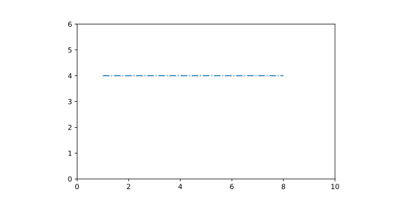
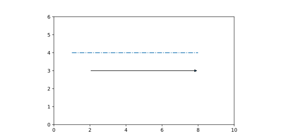
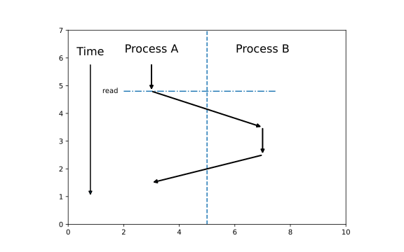

#+title:      lesson4_arrows
#+date:       [2026-10-03 Sat 21:35]
#+filetags:   :matplotlib:
#+identifier: 20261003T213516
* 线条、箭头与连接关系

我们先看最简单的线:

#+begin_src python :session arrow :results silent
  import matplotlib.pyplot as plt

  fig, ax = plt.subplots(figsize=(8, 4))

  ax.set_xlim(0, 10)
  ax.set_ylim(0, 6)
  ax.set_aspect('equal')
#+end_src

#+begin_src python :session arrow :results value file graphics :file figure/arrow.svg
  ax.plot([1, 8], [4 ,4], linestyle="-.")

  fig
#+end_src

#+RESULTS:

这就是一个很简单的线条。线条样式有:

- ~-~: 实线
- ~--~: 虚线
- ~:~: 点线
- ~-.~: 点划线

* 箭头: ~annotate~

比如:

#+begin_src python :session arrow :results value file graphics :file figure/arrow_2.svg
  ax.annotate(
      "",
      xy=(8,3),
      xytext=(2, 3),
      arrowprops={
          "arrowstyle": "-|>"
      }
  )

  fig
#+end_src

#+RESULTS:

其中:

- ~xytext~: 箭头起点
- ~xy~: 箭头终点

~annotate~ 最初用于给图上的某个位置加注释，但如果我们让文字设置为空字符串，那么就是很好用的箭头了。

~arrowprops~ 是箭头属性，比如 ~arrowstyle~ 和 ~linewidth~ 等。

常见的 ~arrowstyle~ 有:

- ~->~
- ~-|>~: 视觉效果更明显

斜向箭头也很好理解，就是让 ~xy~ 和 ~xytext~ x/y的坐标不同即可。

* Process

#+begin_src python :results output file graphics :file figure/process_1.svg
  import matplotlib.pyplot as plt

  fig, ax = plt.subplots(figsize=(8, 5))

  ax.set_xlim(0, 10)
  ax.set_ylim(0, 7)
  ax.set_aspect("equal")
  # ax.axis("off")

  # Process A / B 分隔线
  # ax.plot(
  #     [5, 5],
  #     [0.5, 6.5],
  #     linestyle="--",
  #     linewidth=1
  # )

  ax.axvline(x=5, linestyle="--")

  # 标题
  ax.text(3, 6.3, "Process A",
          ha="center", va="center", fontsize=16)

  ax.text(7, 6.3, "Process B",
          ha="center", va="center", fontsize=16)

  # A 向下
  ax.annotate(
      "",
      xy=(3, 4.8),
      xytext=(3, 5.8),
      arrowprops={
          "arrowstyle": "-|>",
          "linewidth": 2
      }
  )

  # A -> B
  ax.annotate(
      "",
      xy=(7, 3.5),
      xytext=(3, 4.8),
      arrowprops={
          "arrowstyle": "-|>",
          "linewidth": 2
      }
  )

  # B 向下
  ax.annotate(
      "",
      xy=(7, 2.5),
      xytext=(7, 3.5),
      arrowprops={
          "arrowstyle": "-|>",
          "linewidth": 2
      }
  )

  # B -> A
  ax.annotate(
      "",
      xy=(3, 1.5),
      xytext=(7, 2.5),
      arrowprops={
          "arrowstyle": "-|>",
          "linewidth": 2
      }
  )

  # 时间轴

  ax.text(
      0.8, 6.0,
      "Time",
      ha="center",
      va="bottom",
      fontsize=16
  )

  ax.annotate(
      "",
      xy=(0.8, 1),
      xytext=(0.8, 5.8),
      arrowprops={
          "arrowstyle": "-|>",
          "linewidth": 1.5
      }
  )

  ax.text(
      1.8, 4.8,
      "read",
      ha="right",
      va="center"
  )

  ax.plot(
      [2, 7.5],
      [4.8, 4.8],
      linestyle="-."
  )
#+end_src

#+RESULTS:

