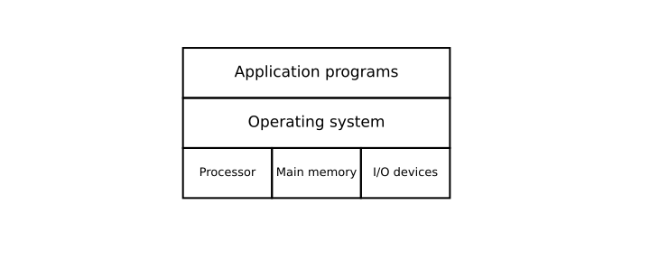

#+title:      lesson5_layout
#+date:       [2026-10-03 Sat 22:03]
#+filetags:   :matplotlib:
#+identifier: 20261003T220324

* 坐标设计、布局与对齐

- 不要直接写“每个对象的位置”
- 先定义“布局规则”
- 再根据计算位置

对于一个示意图，通常可以先规定一个简单范围:

#+begin_src python
  ax.set_xlim(0, 10)
  ax.set_ylim(0, 7)
  ax.aspect('equal')
#+end_src

这样就有了一个从 (0,0) 到 (10, 7) 的矩形。然后我们可以定义边界:

#+begin_src python
  left = 1
  right = 9
  bottom = 1
  top = 6
#+end_src

于是，我们可以绘制的空间就变成了 ~width = right - left~, ~height = top - bottom~ .

#+begin_src python :results output file graphics :file figure/layout.svg
  import matplotlib.pyplot as plt
  from matplotlib.patches import Rectangle

  fig, ax = plt.subplots(figsize=(10, 4))

  ax.set_xlim(0, 11)
  ax.set_ylim(0, 6)
  ax.set_aspect("equal")
  ax.axis("off")

  # 整体布局
  left = 1
  right = 9
  width = right - left

  bottom = 1
  row_height = 1.5

  hardware_y = bottom
  os_y = hardware_y + row_height
  app_y = os_y + row_height
  hardware_fontsize = 13
  
  # Application programs
  app = Rectangle(
      (left, app_y),
      width,
      row_height,
      fill=False,
      linewidth=2
  )
  ax.add_patch(app)

  ax.text(
      left + width / 2,
      app_y + row_height / 2,
      "Application programs",
      ha="center",
      va="center",
      fontsize=17
  )

  # Operating system
  os_rect = Rectangle(
      (left, os_y),
      width,
      row_height,
      fill=False,
      linewidth=2
  )
  ax.add_patch(os_rect)

  ax.text(
      left + width / 2,
      os_y + row_height / 2,
      "Operating system",
      ha="center",
      va="center",
      fontsize=17
  )

  # Hardware
  labels = [
      "Processor",
      "Main memory",
      "I/O devices"
  ]

  cell_width = width / len(labels)

  for i, label in enumerate(labels):
      x = left + i * cell_width

      rect = Rectangle(
          (x, hardware_y),
          cell_width,
          row_height,
          fill=False,
          linewidth=2
      )

      ax.add_patch(rect)

      ax.text(
          x + cell_width / 2,
          hardware_y + row_height / 2,
          label,
          ha="center",
          va="center",
          fontsize=hardware_fontsize

      )

  fig
#+end_src

#+RESULTS:

